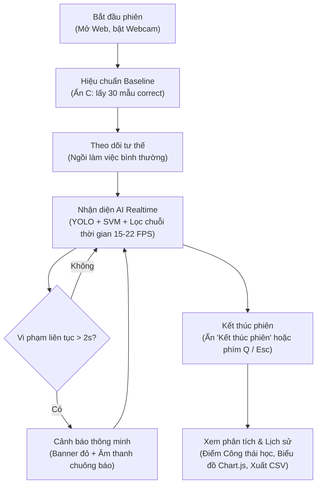
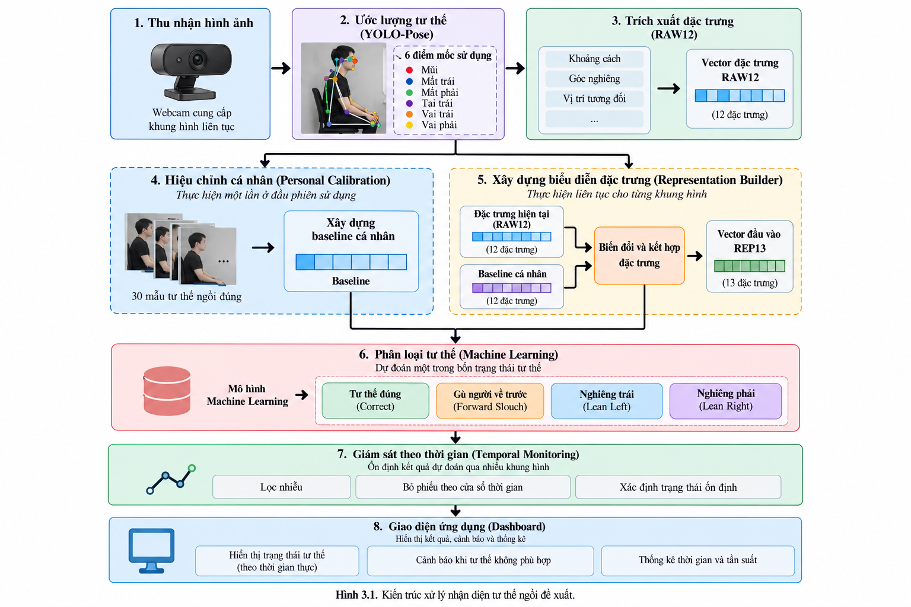
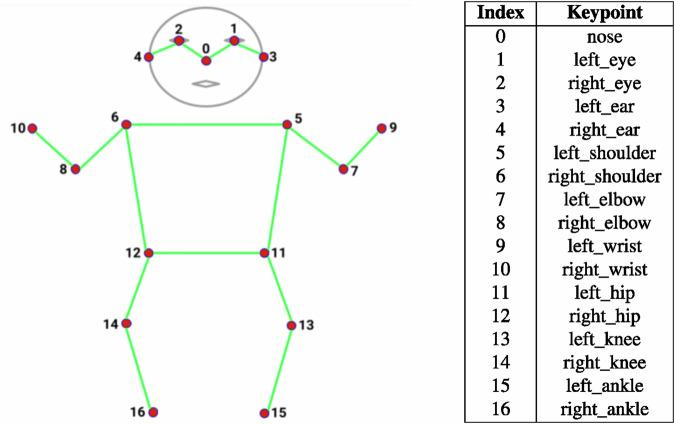
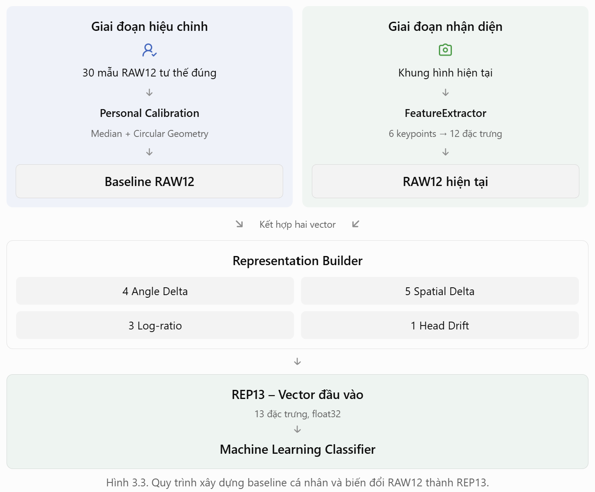
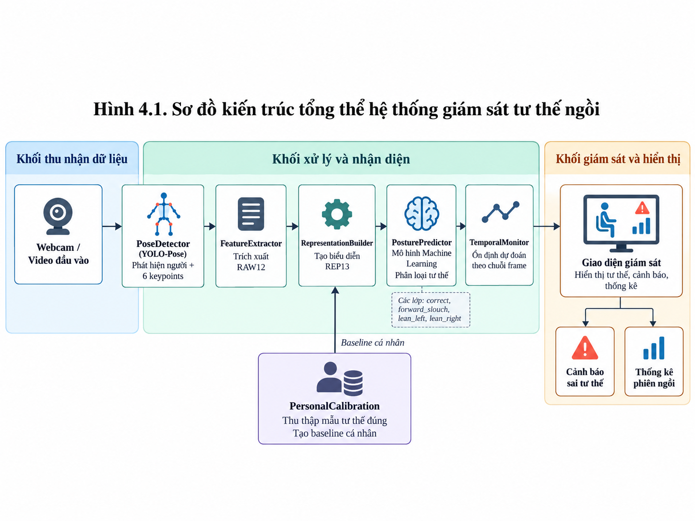
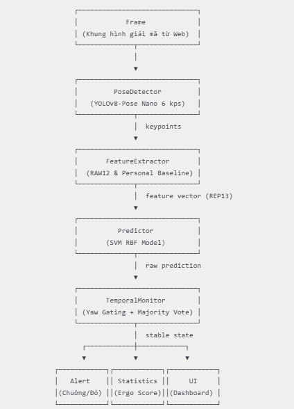
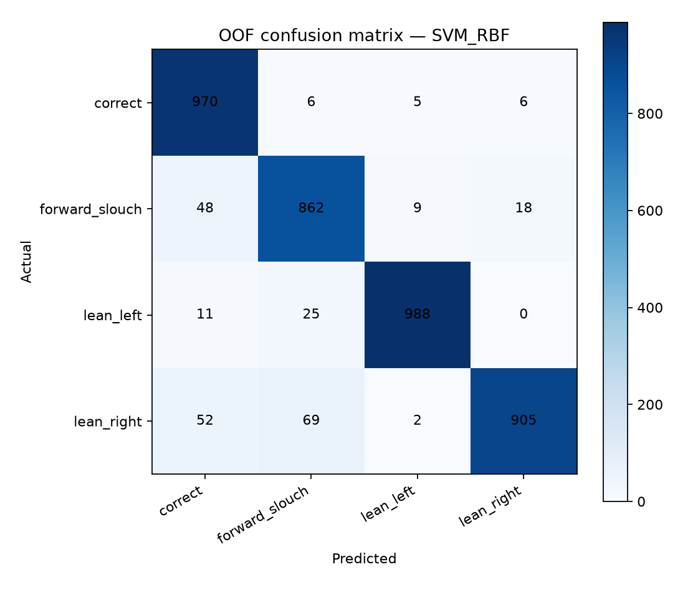
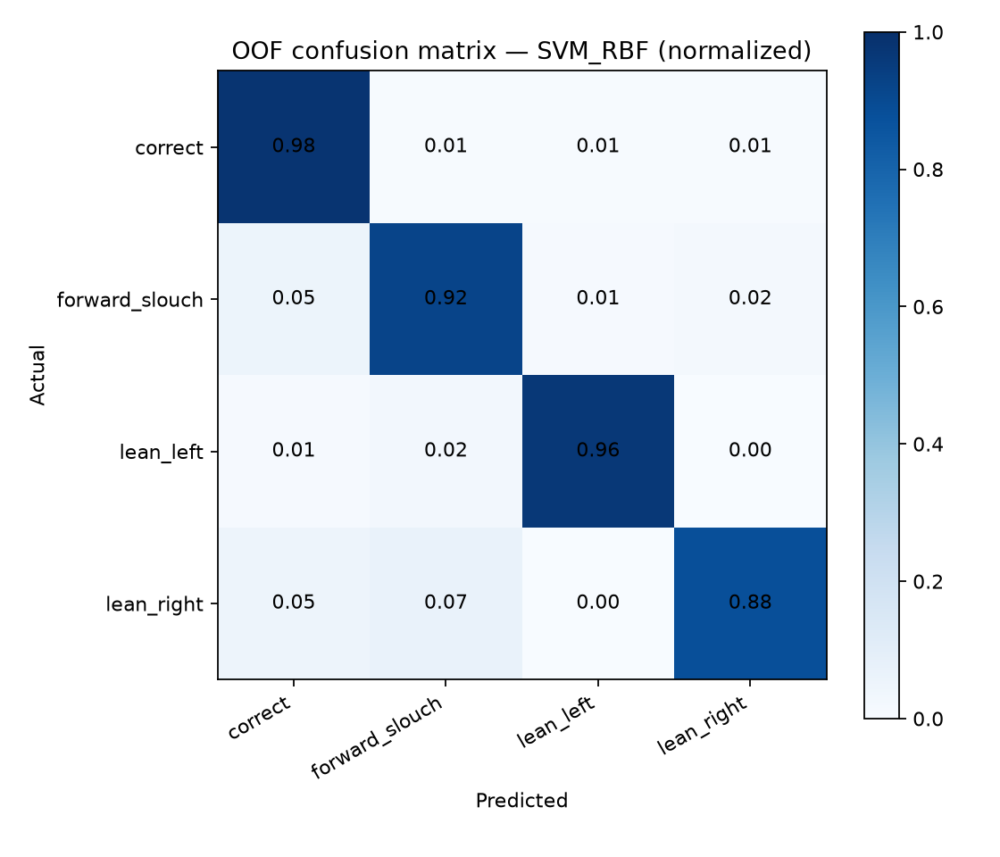

<div align="center">

### HỌC VIỆN CÔNG NGHỆ BƯU CHÍNH VIỄN THÔNG
#### KHOA CÔNG NGHỆ THÔNG TIN 1 – BỘ MÔN LẬP TRÌNH PYTHON


# BÁO CÁO BÀI TẬP LỚN
### Học phần: Lập trình Python

---

## ĐỀ TÀI: “XÂY DỰNG HỆ THỐNG GIÁM SÁT TƯ THẾ NGỒI THỜI GIAN THỰC”
### (SMART POSTURE MONITOR (V03))

---

</div>

**Giảng viên hướng dẫn:** ThS. Phạm Danh Tuyên  
**Sinh viên thực hiện:**
- **Dương Ngọc Quang** – MSV: `B24DCKH112` (Nhóm trưởng)
- **Đặng Xuân Quân** – MSV: `B24DCKH105` (Thành viên)
- **Hoàng Hữu Mạnh** – MSV: `B24DCKH080` (Thành viên)

**Lớp danh nghĩa:** D24CQKH01-B – Hệ Đại học chính quy  
**Thời gian thực hiện:** Hà Nội, Tháng 10 năm 2026

---

## LỜI CẢM ƠN

Lời đầu tiên, nhóm sinh viên chúng em xin được bày tỏ lòng biết ơn chân thành và sâu sắc nhất tới thầy **ThS. Phạm Danh Tuyên** – Giảng viên phụ trách học phần Lập trình Python. Trong suốt quá trình học tập và triển khai đề tài, thầy đã tận tình truyền đạt những kiến thức chuyên môn quý báu, định hướng phương pháp luận nghiên cứu khoa học, đồng thời đưa ra những lời khuyên xác đáng giúp nhóm giải quyết các bài toán kỹ thuật phức tạp từ khâu xử lý ảnh, trích xuất đặc trưng cho đến kiểm thử mô hình học máy theo chuẩn công thái học thực tiễn.

Nhóm cũng xin chân thành cảm ơn các thầy cô giáo trong Khoa Công nghệ Thông tin 1 – Học viện Công nghệ Bưu chính Viễn thông đã tạo điều kiện học tập tốt nhất, cung cấp nền tảng kiến thức vững chắc về lập trình, toán ứng dụng và trí tuệ nhân tạo. Sự đồng hành và động viên của các thầy cô cùng 14 tình nguyện viên tham gia ghi hình xây dựng tập dữ liệu chính là động lực to lớn giúp nhóm hoàn thành đề tài này một cách chỉn chu và trọn vẹn nhất.

*Mặc dù đã rất nỗ lực nghiên cứu và hoàn thiện sản phẩm, đề tài chắc chắn khó tránh khỏi những thiếu sót nhất định do giới hạn về mặt thời gian và điều kiện thực nghiệm. Nhóm chúng em rất mong nhận được những nhận xét, góp ý quý báu từ thầy và hội đồng thẩm định để sản phẩm ngày càng hoàn thiện hơn trong tương lai. Kính chúc thầy sức khỏe, niềm vui và luôn gặt hái nhiều thành công trong sự nghiệp trồng người cao quý!*

## LỜI MỞ ĐẦU

Trong kỷ nguyên số hóa và sự phổ biến của mô hình làm việc từ xa (Remote / Hybrid Work), thời gian làm việc và học tập trước màn hình máy tính ngày càng tăng, phổ biến từ 8 đến 12 tiếng mỗi ngày. Tuy nhiên, việc duy trì tư thế ngồi đúng chuẩn công thái học (Ergonomics) trong thời gian dài là một thách thức rất lớn đối với đa số người sử dụng. Người dùng thường vô thức rơi vào các tư thế sai lệch như cúi đầu về phía trước (Forward Head Posture - thường gọi là hội chứng Text Neck), gù lưng và rướn người về phía màn hình (Forward Slouch), hoặc nghiêng người, vẹo cột sống sang một bên (Lateral Lean). Những tư thế sai này nếu kéo dài liên tục không chỉ gây đau mỏi cơ cổ, vai gáy, thắt lưng mà còn làm tăng áp lực lên đĩa đệm cột sống (có thể lên tới 27 kg khi đầu cúi 60°), dẫn tới nguy cơ thoái hóa đốt sống cổ sớm, thoát vị đĩa đệm và suy giảm nghiêm trọng hiệu suất lao động trí tuệ.

Mặc dù nhận thức rõ tầm quan trọng của việc giữ thẳng lưng, người dùng vẫn rất khó tự phát hiện và sửa sai kịp thời, đặc biệt khi đang tập trung cao độ vào công việc chuyên môn. Các giải pháp truyền thống trên thị trường hiện nay bộc lộ nhiều điểm hạn chế: Các thiết bị cảm biến đeo (wearable sensors) thường gây vướng víu, khó chịu khi sử dụng cả ngày và đòi hỏi chi phí đầu tư phần cứng; trong khi các phần mềm nhắc giờ cố định (như phương pháp Pomodoro) lại không phản ánh đúng tư thế ngồi thực tế. Do đó, việc xây dựng một hệ thống thị giác thông minh có khả năng giám sát tư thế liên tục, phát hiện sai lệch và đưa ra cảnh báo kịp thời theo thời gian thực là một nhu cầu cấp thiết và mang tính ứng dụng xã hội sâu sắc.

Sự phát triển vượt bậc của Trí tuệ nhân tạo (AI) và Thị giác máy tính (Computer Vision) đã mở ra hướng đi tối ưu cho bài toán này. Bằng cách tận dụng trực tiếp webcam máy tính sẵn có, hệ thống có thể theo dõi tư thế mà không gây cảm giác khó chịu cho người dùng, đồng thời tiết kiệm 100% chi phí mua sắm thiết bị ngoại vi chuyên dụng.

Xuất phát từ thực tiễn trên, nhóm lựa chọn thực hiện đề tài: **“Xây dựng hệ thống giám sát tư thế ngồi thời gian thực – Smart Posture Monitor (Phiên bản V03)”**. Hệ thống kết hợp giữa mô hình ước lượng tư thế người siêu nhẹ YOLOv8-Pose và thuật toán phân loại Support Vector Machine (SVM nhân RBF), tích hợp cơ chế hiệu chuẩn cá nhân hóa (Personal Baseline Calibration 30 mẫu) và bộ lọc ổn định chuỗi thời gian (Temporal Smoothing, Hysteresis và Yaw Gating). Toàn bộ pipeline được đóng gói thành một ứng dụng Web Dashboard trực quan, vận hành hoàn toàn Offline trên máy trạm cục bộ, bảo vệ quyền riêng tư tuyệt đối cho người dùng.

## QUY ƯỚC VÀ THUẬT NGỮ

| Thuật ngữ / Viết tắt | Định nghĩa và Ý nghĩa sử dụng trong đề tài |
| --- | --- |
| RAW12 | Vector 12 đặc trưng hình học cơ sở trích xuất trực tiếp từ 6 điểm keypoint vùng đầu và vai trên ảnh 2D. |
| REP13 | Vector 13 đặc trưng đại diện tương đối, được chuẩn hóa từ RAW12 thông qua mốc tham chiếu Baseline cá nhân. |
| Baseline | Vector mốc tham chiếu tư thế ngồi chuẩn công thái học của từng người dùng, thu thập từ 30 khung hình hợp lệ. |
| LOPO CV | Leave-One-Person-Out Cross-Validation: Giao thức kiểm thử chéo loại trừ từng cá nhân độc lập nhằm đánh giá khả năng tổng quát hóa trên người dùng mới. |
| OOF | Out-of-Fold: Tập hợp các dự đoán độc lập trên tập kiểm thử ngoài trong toàn bộ các lượt chia fold. |
| Macro-F1 | Điểm F1 trung bình cộng không trọng số giữa các lớp; đánh giá công bằng hiệu năng phân loại trên tập dữ liệu mất cân bằng. |
| Weighted-F1 | Điểm F1 trung bình có tính đến trọng số tỷ lệ mẫu của từng lớp tư thế. |
| YOLO-Pose | Kiến trúc mạng nơ-ron tích chập thời gian thực (You Only Look Once) chuyên biệt cho tác vụ ước lượng dáng người và định vị khớp xương. |
| Keypoints | Các điểm mốc giải phẫu trên cơ thể người (khớp xương, ngũ quan) được mô hình thị giác định vị tọa độ và độ tin cậy. |
| SVM (Kernel RBF) | Support Vector Machine với nhân Radial Basis Function: Thuật toán học máy phân tách siêu phẳng phi tuyến trong không gian đặc trưng nhiều chiều. |
| Circular Median | Thuật toán xác định trung vị góc có xử lý tính chất tuần hoàn trên đường tròn nhằm triệt tiêu sai số đứt gãy tại chu kỳ ±180°. |
| Temporal Smoothing | Kỹ thuật làm mượt chuỗi thời gian dựa trên cửa sổ trượt bầu chọn đa số (Majority Vote) để loại bỏ nhiễu rung giật nhãn đơn lẻ. |
| Hysteresis | Cơ chế trễ chuyển đổi trạng thái: Yêu cầu trạng thái mới duy trì tối thiểu N khung hình liên tiếp trước khi chính thức chuyển đổi nhãn hiển thị. |
| Yaw Gating | Bộ lọc kiểm soát góc xoay mặt: Sử dụng tỷ lệ khoảng cách mắt - mũi để phát hiện hành vi quay đầu, tự động khóa trạng thái thân trên nhằm chống báo động sai. |
| Ergonomics Score | Điểm số công thái học đánh giá chất lượng phiên ngồi theo thang điểm 100 dựa trên tỷ lệ thời gian ngồi đúng và số lần vi phạm. |
| WebSocket | Giao thức truyền thông hai chiều độ trễ thấp qua một kết nối TCP duy nhất, cho phép truyền nhận luồng video và kết quả AI liên tục giữa Client và Server. |

---

## MỤC LỤC TỔNG THỂ

- [LỜI CẢM ƠN](#lời-cảm-ơn)
- [LỜI MỞ ĐẦU](#lời-mở-đầu)
- [QUY ƯỚC VÀ THUẬT NGỮ](#quy-ước-và-thuật-ngữ)
- [CHƯƠNG 1. TỔNG QUAN BÀI TOÁN VÀ MỤC TIÊU](#chương-1-tổng-quan-bài-toán-và-mục-tiêu)
  - [1.1. Bối cảnh và lý do chọn đề tài](#11-bối-cảnh-và-lý-do-chọn-đề-tài)
  - [1.2. Phát biểu bài toán nhận diện tư thế](#12-phát-biểu-bài-toán-nhận-diện-tư-thế)
  - [1.3. Mục tiêu nghiên cứu và phát triển](#13-mục-tiêu-nghiên-cứu-và-phát-triển)
  - [1.4. Phạm vi và giới hạn của đề tài](#14-phạm-vi-và-giới-hạn-của-đề-tài)
- [CHƯƠNG 2. YÊU CẦU VÀ CHỨC NĂNG HỆ THỐNG](#chương-2-yêu-cầu-và-chức-năng-hệ-thống)
  - [2.1. Yêu cầu chức năng (Functional Requirements)](#21-yêu-cầu-chức-năng-functional-requirements)
  - [2.2. Yêu cầu phi chức năng (Non-Functional Requirements)](#22-yêu-cầu-phi-chức-năng-non-functional-requirements)
  - [2.3. Quy trình người dùng (User Flow)](#23-quy-trình-người-dùng-user-flow)
- [CHƯƠNG 3. PHÂN TÍCH VÀ LỰA CHỌN GIẢI PHÁP](#chương-3-phân-tích-và-lựa-chọn-giải-pháp)
  - [3.1. Phân tích các hướng tiếp cận công nghệ](#31-phân-tích-các-hướng-tiếp-cận-công-nghệ)
  - [3.2. Kiến trúc giải pháp tổng thể đề xuất](#32-kiến-trúc-giải-pháp-tổng-thể-đề-xuất)
  - [3.3. Ước lượng tư thế và lựa chọn điểm mốc cơ thể (Keypoints)](#33-ước-lượng-tư-thế-và-lựa-chọn-điểm-mốc-cơ-thể-keypoints)
  - [3.4. Kỹ thuật thiết kế đặc trưng hình học (RAW12)](#34-kỹ-thuật-thiết-kế-đặc-trưng-hình-học-raw12)
  - [3.5. Hiệu chuẩn cá nhân hóa và Biểu diễn đặc trưng tương đối (REP13)](#35-hiệu-chuẩn-cá-nhân-hóa-và-biểu-diễn-đặc-trưng-tương-đối-rep13)
  - [3.6. Nghiên cứu và lựa chọn mô hình Machine Learning](#36-nghiên-cứu-và-lựa-chọn-mô-hình-machine-learning)
  - [3.7. Bộ lọc chuỗi thời gian (Temporal Monitoring & Yaw Gating)](#37-bộ-lọc-chuỗi-thời-gian-temporal-monitoring--yaw-gating)
- [CHƯƠNG 4. THIẾT KẾ CHƯƠNG TRÌNH VÀ HỆ THỐNG](#chương-4-thiết-kế-chương-trình-và-hệ-thống)
  - [4.1. Kiến trúc phân tầng của hệ thống](#41-kiến-trúc-phân-tầng-của-hệ-thống)
  - [4.2. Thiết kế chi tiết các module nghiệp vụ](#42-thiết-kế-chi-tiết-các-module-nghiệp-vụ)
  - [4.3. Thiết kế luồng xử lý thời gian thực (One-Frame-in-Flight)](#43-thiết-kế-luồng-xử-lý-thời-gian-thực-one-frame-in-flight)
  - [4.4. Quy trình huấn luyện và kiểm thử mô hình](#44-quy-trình-huấn-luyện-và-kiểm-thử-mô-hình)
  - [4.5. Thiết kế giao diện người dùng (Dashboard UI)](#45-thiết-kế-giao-diện-người-dùng-dashboard-ui)
- [CHƯƠNG 5. THƯ VIỆN, FRAMEWORK VÀ CÔNG NGHỆ](#chương-5-thư-viện-framework-và-công-nghệ)
- [CHƯƠNG 6. THỰC NGHIỆM, KẾT QUẢ VÀ MINH HỌA SẢN PHẨM](#chương-6-thực-nghiệm-kết-quả-và-minh-họa-sản-phẩm)
  - [6.1. Thu thập và Phân tích tập dữ liệu thực nghiệm (Dataset & EDA)](#61-thu-thập-và-phân-tích-tập-dữ-liệu-thực-nghiệm-dataset--eda)
  - [6.2. Phương pháp đánh giá mô hình (Nested LOPO CV)](#62-phương-pháp-đánh-giá-mô-hình-nested-lopo-cv)
  - [6.3. Đánh giá và so sánh hiệu năng các mô hình Machine Learning](#63-đánh-giá-và-so-sánh-hiệu-năng-các-mô-hình-machine-learning)
  - [6.4. Đánh giá hiệu năng vận hành thời gian thực](#64-đánh-giá-hiệu-năng-vận-hành-thời-gian-thực)
  - [6.5. Đánh giá hiệu quả của bộ lọc Temporal Monitoring](#65-đánh-giá-hiệu-quả-của-bộ-lọc-temporal-monitoring)
  - [6.6. Đánh giá cơ chế thống kê và Điểm Công thái học](#66-đánh-giá-cơ-chế-thống-kê-và-điểm-công-thái-học)
  - [6.7. Tổng kết đánh giá ưu điểm và hạn chế của hệ thống](#67-tổng-kết-đánh-giá-ưu-điểm-và-hạn-chế-của-hệ-thống)
- [CHƯƠNG 7. PHÂN CHIA CÔNG VIỆC TRONG NHÓM](#chương-7-phân-chia-công-việc-trong-nhóm)
- [CHƯƠNG 8. KẾT LUẬN VÀ HƯỚNG PHÁT TRIỂN](#chương-8-kết-luận-và-hướng-phát-triển)
  - [8.1. Các kết quả chính đạt được](#81-các-kết-quả-chính-đạt-được)
  - [8.2. Những đóng góp nổi bật của đề tài](#82-những-đóng-góp-nổi-bật-của-đề-tài)
  - [8.3. Hạn chế và Hướng phát triển tiếp theo](#83-hạn-chế-và-hướng-phát-triển-tiếp-theo)
- [CHƯƠNG 9. ỨNG DỤNG AI TRONG QUÁ TRÌNH THỰC HIỆN ĐỀ TÀI](#chương-9-ứng-dụng-ai-trong-quá-trình-thực-hiện-đề-tài)
- [TÀI LIỆU THAM KHẢO](#tài-liệu-tham-khảo)
- [PHỤ LỤC. THÔNG TIN KỸ THUẬT BỔ SUNG](#phụ-lục-thông-tin-kỹ-thuật-bổ-sung)
  - [Phụ lục A. Danh mục chi tiết các đặc trưng hình học (RAW12 & REP13)](#phụ-lục-a-danh-mục-chi-tiết-các-đặc-trưng-hình-học-raw12--rep13)
  - [Phụ lục B. Cấu hình huấn luyện và không gian tìm kiếm siêu tham số](#phụ-lục-b-cấu-hình-huấn-luyện-và-không-gian-tìm-kiếm-siêu-tham-số)
  - [Phụ lục C. Các đoạn mã nguồn trọng yếu của hệ thống](#phụ-lục-c-các-đoạn-mã-nguồn-trọng-yếu-của-hệ-thống)
  - [Phụ lục D. Kết quả thực nghiệm chi tiết từng Fold và từng cá nhân](#phụ-lục-d-kết-quả-thực-nghiệm-chi-tiết-từng-fold-và-từng-cá-nhân)
  - [Phụ lục E. Cấu trúc mã nguồn Repository và Hướng dẫn triển khai](#phụ-lục-e-cấu-trúc-mã-nguồn-repository-và-hướng-dẫn-triển-khai)

---

# CHƯƠNG 1. TỔNG QUAN BÀI TOÁN VÀ MỤC TIÊU

## 1.1. Bối cảnh và lý do chọn đề tài
Trong thời đại cách mạng công nghiệp 4.0, máy tính cá nhân và laptop đã trở thành công cụ lao động không thể thiếu đối với học sinh, sinh viên và nhân viên văn phòng. Tuy nhiên, thói quen ngồi làm việc tĩnh tại liên tục trong nhiều giờ liền lại kéo theo những hiểm họa khôn lường đối với sức khỏe cơ xương khớp.

Các nghiên cứu y khoa về công thái học (Ergonomics) chỉ ra rằng, khi quá tập trung vào màn hình, con người có xu hướng vô thức rướn cổ về phía trước, gù lưng hoặc nghiêng vẹo sang một bên để giảm bớt sự căng thẳng của cơ bắp. Cứ mỗi 2.5 cm đầu dịch chuyển về phía trước, áp lực đè nặng lên các đốt sống cổ lại tăng thêm tương đương gần 4.5 kg. Ở trạng thái cúi 60°, sức nặng mà cột sống cổ phải chịu tải có thể lên tới 27 kg. Về lâu dài, các thói quen xấu này dẫn tới các chứng bệnh mãn tính nguy hiểm: hội chứng cổ rùa (Text Neck Syndrome), thoái hóa cột sống cổ sớm, thoát vị đĩa đệm, đau dây thần kinh tọa và cong vẹo cột sống học đường.

Mặc dù người dùng đều ý thức được tác hại này, họ không thể tự kiểm soát tư thế của mình một cách liên tục nếu thiếu một công cụ hỗ trợ thông minh. Các thiết bị cảm biến đeo (wearable sensors) thường gây khó chịu, vướng víu và bất tiện khi phải sạc pin thường xuyên; trong khi các ứng dụng hẹn giờ cố định (Pomodoro) không có khả năng giám sát trực quan xem người dùng có thực sự ngồi đúng hay không. Xuất phát từ thực trạng đó, nhóm quyết định nghiên cứu và xây dựng hệ thống **Smart Posture Monitor** nhằm tự động phát hiện, đánh giá và nhắc nhở tư thế ngồi thời gian thực thông qua webcam máy tính.

## 1.2. Phát biểu bài toán nhận diện tư thế
Bài toán đặt ra cho hệ thống là: Từ luồng video đầu vào (Input Frames) thu nhận liên tục từ webcam 2D tiêu chuẩn của máy tính, hệ thống cần tự động phát hiện người, định vị các điểm mốc giải phẫu trọng yếu trên cơ thể, trích xuất các đặc trưng hình học có ý nghĩa và phân loại chính xác trạng thái ngồi hiện tại của người dùng vào một trong bốn nhãn lớp công thái học:
1. **`correct`**: Tư thế ngồi thẳng lưng, cổ và vai cân bằng đúng chuẩn công thái học.
2. **`forward_slouch`**: Tư thế cúi đầu, rướn cổ hoặc gù lưng về phía màn hình máy tính.
3. **`lean_left`**: Tư thế nghiêng đầu hoặc vẹo cột sống sang phía bên trái.
4. **`lean_right`**: Tư thế nghiêng đầu hoặc vẹo cột sống sang phía bên phải.

Đồng thời, hệ thống phải theo dõi chuỗi thời gian để kích hoạt cảnh báo thông minh (banner đỏ thị giác + chuông âm thanh) khi người dùng duy trì tư thế sai liên tục vượt quá ngưỡng thời gian cho phép (mặc định 2.0 giây), và tổng kết phiên làm việc qua Điểm số Công thái học (Ergonomics Score).

## 1.3. Mục tiêu nghiên cứu và phát triển
Để giải quyết trọn vẹn bài toán trên, nhóm đặt ra ba mục tiêu nghiên cứu cốt lõi:
- **Mục tiêu 1 – Độ chính xác và Cá nhân hóa cao:** Thay vì áp dụng ngưỡng cứng nhắc cho mọi đối tượng, hệ thống phải có khả năng thích ứng linh hoạt với sự khác biệt về vóc dáng, chiều cao, chiều dài cổ và khoảng cách đặt webcam của từng cá nhân thông qua cơ chế Personal Baseline Calibration 30 mẫu, chuyển đổi từ RAW12 sang không gian đặc trưng tương đối REP13.
- **Mục tiêu 2 – Tính ổn định thời gian thực:** Khắc phục triệt để hiện tượng nhấp nháy chuyển nhãn (flickering) và triệt tiêu báo động sai khi người dùng chỉ quay đầu nói chuyện thông qua bộ lọc Yaw Gating kết hợp cửa sổ trượt Majority Vote và cơ chế trễ Hysteresis.
- **Mục tiêu 3 – Tính ứng dụng thực tiễn và Bảo mật:** Triển khai một ứng dụng Web Dashboard hoàn chỉnh, giao diện Shadcn UI hiện đại, hỗ trợ Dark/Light mode, biểu đồ Chart.js trực quan, và bảo đảm vận hành 100% Offline trên CPU máy tính văn phòng, bảo mật tuyệt đối dữ liệu hình ảnh người dùng.

## 1.4. Phạm vi và giới hạn của đề tài
- **Về bài toán và dữ liệu:** Hệ thống tập trung phân loại 4 trạng thái tư thế ngồi làm việc phổ biến nhất của phần thân trên dựa trên dữ liệu ảnh 2D RGB từ webcam thông thường, chưa mở rộng sang ước lượng chiều sâu 3D (Depth camera) hoặc phân tích tư thế phần thân dưới (hông, chân).
- **Về giao thức bố trí camera:** Camera được đặt cố định ở góc chếch khoảng **45° về phía bên trái** của người dùng (góc quan sát tối ưu nhất để nhìn rõ đồng thời cả độ gập cổ và độ nghiêng vai). Ảnh đầu vào là ảnh gốc không lật gương (unmirrored) để đảm bảo phân định chính xác hướng nghiêng trái / phải.
- **Về quy trình vận hành:** Người dùng cần thực hiện bước hiệu chuẩn mốc chuẩn cá nhân (ngồi thẳng lưng trong khoảng 2-3 giây đầu để thu 30 mẫu correct) trước khi bước vào phiên giám sát tự động.
- **Về mục đích ứng dụng:** Sản phẩm hướng tới mục tiêu hỗ trợ cải thiện thói quen ngồi làm việc và nâng cao nhận thức bảo vệ sức khỏe, không đóng vai trò là thiết bị chẩn đoán y khoa chuyên dụng.

---

# CHƯƠNG 2. YÊU CẦU VÀ CHỨC NĂNG HỆ THỐNG

## 2.1. Yêu cầu chức năng (Functional Requirements)
Hệ thống Smart Posture Monitor được phân rã thành 7 phân hệ nghiệp vụ chính:
1. **Phân hệ thu nhận và xử lý hình ảnh (Video & Frame Acquisition):** Thu nhận luồng webcam 640x480 qua Web API, mã hóa Base64 và truyền tải hai chiều độ trễ thấp qua WebSocket (`/ws/stream`). Đo độ trễ trọn vòng Ping (ms).
2. **Phân hệ thị giác máy tính và trích xuất đặc trưng (Computer Vision & Feature Engineering):** Định vị dáng người và trích xuất 6 điểm mốc giải phẫu cốt lõi bằng YOLOv8-Pose Nano. Lọc chủ thể trung tâm qua điểm kết hợp $S_i = 0.7 \cdot C_i + 0.3 \cdot P_i$. Trích xuất vector 12 đặc trưng hình học thô (RAW12).
3. **Phân hệ hiệu chuẩn tư thế cá nhân hóa (Personal Baseline Calibration):** Thu thập 30 mẫu correct hợp lệ đầu phiên. Áp dụng thuật toán Circular Median cho góc và Median cho khoảng cách để xây dựng Baseline, sau đó tạo vector đặc trưng tương đối 13 chiều (REP13).
4. **Phân hệ suy luận và phân loại tư thế (Posture Classification):** Phân loại đa lớp 4 trạng thái tư thế ngồi bằng mô hình SVM (Kernel RBF) và ước lượng phân bố xác suất tin cậy tức thời.
5. **Phân hệ hậu xử lý và làm mượt thời gian (Temporal Processing):** Bộ lọc Yaw Gating khử nhiễu quay đầu; Cửa sổ trượt đa số Majority Vote ($W=7$ frames); và Cơ chế trễ chuyển đổi trạng thái Hysteresis (2 frames).
6. **Phân hệ cảnh báo và thống kê phiên làm việc (Alerting & Ergonomics Statistics):** Kích hoạt cảnh báo kép (Banner đỏ nhấp nháy + Âm thanh chuông báo Bip) khi ngồi sai liên tục $> 2.0\text{s}$. Gom đợt vi phạm liên tục thành 1 lần (Violation Episode). Chấm Điểm Công thái học (Ergonomics Score từ 0 đến 100).
7. **Phân hệ bảng điều khiển và trực quan hóa (Dashboard UI):** Khung webcam có lớp vẽ khung xương 6 điểm (Canvas Overlay); Ma trận 4 thẻ KPI chỉ số; Biểu đồ phân tích Chart.js; Quản lý lịch sử phiên và hỗ trợ xuất báo cáo CSV/Excel.

## 2.2. Yêu cầu phi chức năng (Non-Functional Requirements)

| Nhóm yêu cầu | Tiêu chuẩn kỹ thuật đặt ra | Giải thích ý nghĩa và Giải pháp kỹ thuật trong dự án |
| --- | --- | --- |
| Tính thời gian thực (Real-time) | Tốc độ xử lý: 15 – 22 FPS<br>Tổng độ trễ: < 80 ms | Toàn bộ pipeline AI xử lý mượt mà trên CPU máy tính văn phòng thông thường, phản hồi kết quả tức thì lên giao diện web. |
| Độ ổn định chuỗi thời gian (Temporal Stability) | Kháng nhiễu khung hình, triệt tiêu rung giật nhãn | Loại bỏ hoàn toàn hiện tượng nhấp nháy nhãn (flickering) thông qua bộ lọc Yaw Gating và cơ chế kép Majority Vote + Hysteresis. |
| Tính dễ sử dụng & Tiếp cận (Usability) | Không cần thiết bị chuyên dụng, giao diện thân thiện | Chỉ yêu cầu webcam laptop sẵn có và trình duyệt web. Hỗ trợ đầy đủ phím tắt nhanh (C hiệu chuẩn, R đặt lại, Q dừng). |
| Kiến trúc module hóa (Modularity) | Tuân thủ chặt chẽ nguyên lý Single Responsibility | Các khối PoseDetector, FeatureExtractor, Calibration, Predictor, Monitor độc lập, có thể dễ dàng bảo trì và viết Unit Test. |
| Hoạt động Ngoại tuyến & Bảo mật (Offline & Privacy) | Xử lý cục bộ 100% trên thiết bị người dùng | Không lưu trữ hay truyền tải bất kỳ hình ảnh nhạy cảm nào của người dùng lên đám mây, bảo đảm quyền riêng tư tuyệt đối. |
| Độ chính xác & Khái quát hóa (Generalization) | Macro F1-score: > 0.90 trên người dùng chưa từng thấy | Mô hình đạt Macro F1 trung bình 0.9199 qua kiểm thử nghiêm ngặt Nested Leave-One-Person-Out CV trên 14 người dùng độc lập. |

## 2.3. Quy trình người dùng (User Flow)


---

# CHƯƠNG 3. PHÂN TÍCH VÀ LỰA CHỌN GIẢI PHÁP

## 3.1. Phân tích các hướng tiếp cận công nghệ

| Tiêu chí so sánh | Quy tắc hình học (Rule-based) | Học sâu trực tiếp (End-to-End DL) | Pose Estimation + Feature + ML (Đề xuất) |
| --- | --- | --- | --- |
| Dữ liệu huấn luyện bộ phân loại | Không yêu cầu (dựa trên ngưỡng cứng) | Rất lớn và đa dạng hình ảnh | Vừa phải (tập trung vào vector đặc trưng hình học) |
| Độ phức tạp tính toán suy luận | Rất thấp | Rất cao (xử lý toàn bộ pixel trên GPU) | Thấp đến trung bình (chạy mượt trên CPU máy tính văn phòng) |
| Khả năng giải thích (Interpretability) | Rất cao (ngưỡng góc tường minh) | Hộp đen (Black-box), khó chẩn đoán lỗi | Rất cao (đặc trưng góc, khoảng cách, độ lệch tương đối rõ ràng) |
| Khả năng thích ứng theo cá nhân | Rất kém (ngưỡng cứng sai lệch theo thể trạng) | Khó can thiệp cá nhân hóa nhanh | Rất tốt (tích hợp Personal Baseline Calibration 30 mẫu) |
| Độ bền vững trước nhiễu ngoại cảnh | Kém (nhạy với góc camera và rung động) | Phụ thuộc vào ánh sáng và bối cảnh phòng | Rất tốt (Pose model lọc nhiễu nền; đặc trưng chuẩn hóa theo vai) |

## 3.2. Kiến trúc giải pháp tổng thể đề xuất

*Hình 3.1: Sơ đồ kiến trúc xử lý nhận diện tư thế ngồi đề xuất (Pipeline V03).*

### Quá trình phát triển và cải tiến qua các phiên bản (V01, V02, V03)

| Tiêu chí kỹ thuật | Phiên bản V01 (Baseline) | Phiên bản V02 (Mở rộng) | Phiên bản V03 (Hoàn thiện - Đề xuất) |
| --- | --- | --- | --- |
| Hướng tiếp cận | Pose 17 kps + 18 đặc trưng tuyệt đối + ML | Pose 17 kps + 29 đặc trưng góc/khoảng cách + ML | Pose 6 kps + RAW12 + Personal Calibration + REP13 + SVM |
| Số lượng keypoint sử dụng | 17 keypoint toàn thân (nhiều điểm thừa) | 17 keypoint toàn thân | 6 keypoint vùng đầu - vai (Mũi, 2 Mắt, Tai trái, 2 Vai) |
| Cơ chế cá nhân hóa | Không có | Không có | Personal Calibration (30 mẫu correct, Circular Median) |
| Không gian đặc trưng | 18 đặc trưng pixel thô tuyệt đối | 29 đặc trưng hình học tuyệt đối | RAW12 (Hình học thô) → REP13 (Độ lệch tương đối & Tỷ lệ) |
| Xử lý chuỗi thời gian | Không có (dự đoán từng frame riêng rẽ) | Bộ lọc trung bình trượt đơn giản | Temporal Smoothing (Majority Vote W=7) + Hysteresis + Yaw Gating |
| Giao thức kiểm thử | K-Fold ngẫu nhiên (Rò rỉ chủ thể) | Group K-Fold | Nested Leave-One-Person-Out CV (14 folds ngoài, 4 folds trong) |
| Độ chính xác Macro F1 | 0.782 | 0.846 | 0.9199 (LOPO F1) / 0.9363 (OOF F1) |
| Mục tiêu trọng tâm | Kiểm chứng tính khả thi | Tối ưu hóa số lượng đặc trưng | Cá nhân hóa, chống rung giật thời gian thực và ứng dụng web |

> [!IMPORTANT]
> **Điểm đột phá mang tính quyết định của Phiên bản V03:**
> Khác biệt căn bản giữa V03 và các phiên bản trước là sự ra đời của cơ chế **Personal Calibration**. Thay vì cố gắng tìm kiếm một đường biên quyết định toàn cục trên các tọa độ hình học tuyệt đối (vốn luôn bị biến dạng bởi chiều cao, độ rộng vai và cự ly ngồi của từng người), V03 chuyển đổi toàn bộ bài toán sang không gian độ lệch tương đối (Relative Space) so với chính tư thế chuẩn của người đó. Nhờ vậy, độ phân tán dữ liệu giữa các cá nhân giảm mạnh 33.8%, nâng Macro F1 trên người dùng mới từ 0.846 lên 0.9199.

## 3.3. Ước lượng tư thế và lựa chọn điểm mốc cơ thể (Keypoints)

*Hình 3.2: Minh họa 17 điểm mốc cơ thể theo định dạng COCO của YOLO-Pose.*

Nhóm tinh gọn lại đúng 6 điểm mốc cốt lõi thuộc vùng thân trên:

| STT | Tên Keypoint (COCO) | Chỉ số Index | Tọa độ trích xuất | Vai trò và Ý nghĩa sinh trắc học trong hệ thống |
| --- | --- | --- | --- | --- |
| 1 | Nose (Mũi) | 0 | (x_0, y_0, conf_0) | Mốc trung tâm khuôn mặt; kết hợp tai trái xác định hướng cúi đầu (neck pitch) và tỷ lệ quay mặt (yaw proxy). |
| 2 | Left Eye (Mắt trái) | 1 | (x_1, y_1, conf_1) | Kết hợp mắt phải xác định trục nghiêng đầu (eye roll), tâm mắt và khoảng cách gian đồng tử. |
| 3 | Right Eye (Mắt phải) | 2 | (x_2, y_2, conf_2) | Cùng mắt trái xác định đường cơ sở khuôn mặt và độ lệch ngang/dọc giữa đầu và thân mình. |
| 4 | Left Ear (Tai trái) | 3 | (x_3, y_3, conf_3) | Điểm mốc bên hông đầu quan sát rõ nhất từ góc camera 45° bên trái; tính góc gập cổ (neck flexion). |
| 5 | Left Shoulder (Vai trái) | 5 | (x_5, y_5, conf_5) | Kết hợp vai phải xác định trục nghiêng thân trên (shoulder roll), tâm vai và độ rộng vai cơ sở. |
| 6 | Right Shoulder (Vai phải) | 6 | (x_6, y_6, conf_6) | Cùng vai trái xác định đường vai; dùng làm mẫu số chuẩn hóa độ rộng vai (W_0) cho mọi khoảng cách. |

### Thuật toán chọn lọc chủ thể trung tâm tối ưu
Điểm ưu tiên $S_i$ cho từng người $i$ phát hiện được xác định theo công thức:
$$S_i = 0.7 \cdot C_i + 0.3 \cdot P_i$$
Trong đó $C_i$ là chỉ số đo mức độ gần tâm hình ảnh (centrality, từ 0 đến 1), và $P_i$ là độ tin cậy phát hiện người do YOLO cung cấp.

## 3.4. Kỹ thuật thiết kế đặc trưng hình học (RAW12)
Từ tọa độ 6 điểm mốc giải phẫu hợp lệ, hệ thống tính toán 12 đặc trưng hình học thô (RAW12):

| Mã | Tên đặc trưng | Nhóm đặc trưng | Công thức toán học | Đơn vị | Mô tả ý nghĩa hình học |
| --- | --- | --- | --- | --- | --- |
| RAW01 | shoulder_roll_deg | Hướng (Orientation) | atan2(y_rs - y_ls, x_rs - x_ls) * 180 / π | Độ (°) | Góc nghiêng của đường nối hai vai so với trục hoành ảnh. |
| RAW02 | eye_roll_deg | Hướng (Orientation) | atan2(y_re - y_le, x_re - x_le) * 180 / π | Độ (°) | Góc nghiêng của đường nối hai mắt so với trục hoành ảnh. |
| RAW03 | head_shoulder_roll_diff_deg | Hướng (Orientation) | wrap(eye_roll_deg - shoulder_roll_deg) | Độ (°) | Độ lệch góc giữa trục đầu và trục vai (nhận diện vẹo cổ độc lập với vai). |
| RAW04 | neck_pitch_deg | Mặt đứng dọc (Sagittal) | atan2(y_nose - y_lear, x_nose - x_lear) * 180 / π | Độ (°) | Góc nghiêng của đoạn nối tai trái - mũi; phản ánh mức độ cúi/ngẩng đầu ở góc 45°. |
| RAW05 | eye_center_x_px | Không gian (Spatial) | (x_le + x_re) / 2 | Pixel | Tọa độ hoành độ trung tâm vùng mắt (đại diện vị trí đầu). |
| RAW06 | eye_center_y_px | Không gian (Spatial) | (y_le + y_re) / 2 | Pixel | Tọa độ tung độ trung tâm vùng mắt (phát hiện đầu sụt xuống khi gù). |
| RAW07 | shoulder_center_x_px | Không gian (Spatial) | (x_ls + x_rs) / 2 | Pixel | Tọa độ hoành độ trung tâm hai vai (đại diện vị trí thân trên). |
| RAW08 | eye_shoulder_vertical_gap_px | Không gian (Spatial) | y_shoulder_center - y_eye_center | Pixel | Khoảng cách thẳng đứng từ tâm mắt đến tâm vai (thu nhỏ khi rướn/gù). |
| RAW09 | eye_shoulder_horizontal_offset_px | Không gian (Spatial) | x_eye_center - x_shoulder_center | Pixel | Độ lệch ngang có dấu giữa tâm mắt và tâm vai (phát hiện lệch trục đầu/thân). |
| RAW10 | inter_eye_distance_px | Phối cảnh & Tỷ lệ | sqrt((x_re - x_le)^2 + (y_re - y_le)^2) | Pixel | Khoảng cách Euclidean hai mắt; thay đổi theo cự ly người đến camera. |
| RAW11 | ear_nose_horizontal_span_px | Phối cảnh & Tỷ lệ | |x_nose - x_lear| | Pixel | Độ chênh lệch hoành độ tai-mũi; nhạy với góc quay mặt (yaw) và rướn cổ. |
| RAW12 | shoulder_width_px | Phối cảnh & Tỷ lệ | sqrt((x_rs - x_ls)^2 + (y_rs - y_ls)^2) | Pixel | Khoảng cách Euclidean hai vai; dùng làm thước đo chuẩn hóa cơ thể. |

## 3.5. Hiệu chuẩn cá nhân hóa và Biểu diễn đặc trưng tương đối (REP13)

*Hình 3.3: Quy trình hiệu chuẩn Baseline cá nhân hóa và biến đổi RAW12 sang REP13.*

- **Thuật toán Circular Median cho góc tuần hoàn:**
  $$	heta_{	ext{ref}} = rg\min_{	heta_i} \sum_{j=1}^{30} |	ext{wrap}(	heta_i - 	heta_j)|$$
  Sau khi chọn góc tham chiếu $	heta_{	ext{ref}}$, mở rộng các góc trên đường tròn và tính trung vị tuyến tính.
- **Chuẩn hóa khoảng cách theo độ rộng vai $W_0$:**
  $$\Delta s_j = rac{s_j - b_j}{W_0}$$
- **Đại lượng tỷ số log khoảng cách (Log-ratio):**
  $$r_j = \ln\left(rac{s_j}{b_j}
ight)$$
- **Độ lớn dịch chuyển tổng hợp của đầu (Head Drift Magnitude):**
  $$D = \sqrt{(\Delta 	ext{eye\_center\_x\_body})^2 + (\Delta 	ext{eye\_center\_y\_body})^2}$$


| Mã | Tên đặc trưng | Nguồn gốc RAW | Công thức biến đổi từ Baseline cá nhân | Miền giá trị | Ý nghĩa phân lớp |
| --- | --- | --- | --- | --- | --- |
| REP01 | delta_shoulder_roll_deg | RAW01 | wrap(RAW01 - Baseline[0]) | [-180°, 180°) | Độ lệch nghiêng vai so với tư thế chuẩn (phân biệt lean_left / lean_right). |
| REP02 | delta_eye_roll_deg | RAW02 | wrap(RAW02 - Baseline[1]) | [-180°, 180°) | Độ lệch nghiêng đầu so với tư thế chuẩn. |
| REP03 | delta_head_shoulder_roll_diff_deg | RAW03 | wrap(RAW03 - Baseline[2]) | [-180°, 180°) | Biến thiên mức độ vặn lệch giữa đầu và vai. |
| REP04 | delta_neck_pitch_deg | RAW04 | wrap(RAW04 - Baseline[3]) | [-180°, 180°) | Biến thiên góc gập cổ (chỉ số chính nhận diện forward_slouch). |
| REP05 | delta_eye_center_x_body | RAW05 | (RAW05 - Baseline[4]) / W_0 | (-∞, +∞) | Độ dịch ngang của đầu chuẩn hóa theo độ rộng vai. |
| REP06 | delta_eye_center_y_body | RAW06 | (RAW06 - Baseline[5]) / W_0 | (-∞, +∞) | Độ sụt dọc của đầu chuẩn hóa theo độ rộng vai (gap = 1.387 cho forward_slouch). |
| REP07 | delta_shoulder_center_x_body | RAW07 | (RAW07 - Baseline[6]) / W_0 | (-∞, +∞) | Độ dịch ngang thân mình chuẩn hóa (phân tách mạnh giữa lean_left và lean_right). |
| REP08 | delta_eye_shoulder_vertical_gap_body | RAW08 | (RAW08 - Baseline[7]) / W_0 | (-∞, +∞) | Độ co ngắn khoảng cách đầu-vai chuẩn hóa theo vai. |
| REP09 | delta_eye_shoulder_horizontal_offset_body | RAW09 | (RAW09 - Baseline[8]) / W_0 | (-∞, +∞) | Độ lệch tâm đầu-vai tương đối chuẩn hóa. |
| REP10 | log_ratio_inter_eye_distance | RAW10 | ln(RAW10 / Baseline[9]) | (-∞, +∞) | Tỷ số log khoảng cách mắt; >0 khi tiến sát camera, <0 khi lùi xa. |
| REP11 | log_ratio_ear_nose_horizontal_span | RAW11 | ln(RAW11 / Baseline[10]) | (-∞, +∞) | Tỷ số log độ rộng tai-mũi; biến thiên khi rướn về trước. |
| REP12 | log_ratio_shoulder_width | RAW12 | ln(RAW12 / Baseline[11]) | (-∞, +∞) | Tỷ số log độ rộng hai vai; phản ánh góc nghiêng thân và phối cảnh. |
| REP13 | head_drift_magnitude | REP05, REP06 | sqrt((REP05)^2 + (REP06)^2) | [0, +∞) | Độ lớn dịch chuyển tổng hợp của đầu (gap = 1.961 phân biệt correct và lean). |

## 3.6. Nghiên cứu và lựa chọn mô hình Machine Learning

| Tiêu chí | SVM (Kernel RBF) | Random Forest | XGBoost | Đa tầng nơ-ron (MLP) |
| --- | --- | --- | --- | --- |
| Bản chất toán học | Phân tách siêu phẳng phi tuyến lề cực đại qua không gian Hilbert | Tổ hợp biểu quyết của nhiều cây quyết định độc lập (Bagging) | Tối ưu hóa hàm mất mát bằng chuỗi cây quyết định tuần tự (Gradient Boosting) | Mạng nơ-ron truyền thẳng học biểu diễn qua các hàm kích hoạt phi tuyến |
| Xử lý quan hệ phi tuyến | Xuất sắc (nhân RBF tự động biến đổi sang không gian vô hạn chiều) | Tốt (chia cắt trực giao từng thuộc tính) | Rất tốt (học tương tác phức tạp) | Xuất sắc (các tầng ẩn phi tuyến) |
| Độ nhạy với chuẩn hóa dữ liệu | Rất nhạy (đòi hỏi đặc trưng cùng thang đo) | Không nhạy với thang đo | Không nhạy với thang đo | Rất nhạy (cần chuẩn hóa và điều chuẩn trọng số) |
| Khả năng tổng quát hóa với dữ liệu ít | Rất cao (kháng overfitting tốt nhờ tối ưu lề cực đại) | Trung bình (dễ overfit trên tập dữ liệu nhỏ) | Trung bình (cần tinh chỉnh nhiều tham số) | Kém trên tập dữ liệu nhỏ (dễ overfit hoặc bất ổn định) |
| Thời gian suy luận thời gian thực | < 0.5 ms / mẫu (rất nhẹ khi số vector hỗ trợ vừa phải) | ~ 2 - 5 ms / mẫu (tùy số lượng cây) | ~ 1 - 3 ms / mẫu | ~ 0.5 - 1 ms / mẫu |
| Bộ siêu tham số chính | C, gamma, class_weight | n_estimators, max_depth, min_samples_split | n_estimators, learning_rate, max_depth, reg_lambda | hidden_layer_sizes, alpha, learning_rate_init |

## 3.7. Bộ lọc chuỗi thời gian (Temporal Monitoring & Yaw Gating)
- **Khử nhiễu quay đầu (Yaw Gating):** Đo tỷ lệ khoảng cách mắt - mũi $R = rac{d(	ext{Left Eye}, 	ext{Nose})}{d(	ext{Right Eye}, 	ext{Nose})}$. Khi $R < 0.45$ hoặc $R > 1.80$, hệ thống tự động khóa trạng thái thân trên ổn định trước đó.
- **Cửa sổ trượt đa số (Majority Vote $W=7$):** Bầu chọn nhãn chiếm đa số tuyệt đối trong 7 khung hình gần nhất.
- **Cơ chế trễ trạng thái (Hysteresis):** Yêu cầu nhãn ứng viên mới duy trì liên tiếp 2 khung hình trước khi chuyển trạng thái hiển thị.

---

# CHƯƠNG 4. THIẾT KẾ CHƯƠNG TRÌNH VÀ HỆ THỐNG

## 4.1. Kiến trúc phân tầng của hệ thống

*Hình 4.1: Sơ đồ kiến trúc tổng thể hệ thống giám sát tư thế ngồi (3 phân tầng chính).*

## 4.2. Thiết kế chi tiết các module nghiệp vụ

| Module | File cài đặt | Chức năng chính | Đầu vào | Đầu ra |
| --- | --- | --- | --- | --- |
| PoseDetector | src/pose_detector.py | Phát hiện người trung tâm và trích xuất 6 keypoints vùng đầu-vai bằng YOLOv8-Pose Nano. | Ảnh RGB (np.ndarray 640x480) | Tọa độ 6 keypoint (x, y, conf) |
| FeatureExtractor | src/feature_extractor.py | Kiểm tra tính hợp lệ hình học và tính toán 12 đặc trưng hình học thô (RAW12). | Tọa độ 6 keypoint | Vector RAW12 (12 float32) |
| PersonalCalibration | src/personal_calibration.py | Thu thập 30 mẫu correct hợp lệ và tính vector Baseline bằng Circular Median và Median. | Chuỗi mẫu RAW12 correct | Vector Baseline cá nhân (12 float32) |
| RepresentationBuilder | src/representation_builder.py | Biến đổi vector RAW12 và Baseline thành vector đại diện tương đối 13 chiều (REP13). | RAW12 hiện tại + Baseline | Vector REP13 (13 float32) |
| PosturePredictor | src/posture_predictor.py | Nạp mô hình SVM RBF đã huấn luyện và dự đoán xác suất, nhãn tư thế tức thời. | Vector REP13 | Nhãn thô và phân bố xác suất |
| TemporalMonitor | src/temporal_monitor.py | Ổn định chuỗi thời gian bằng Yaw Gating, Sliding Window Majority Vote và Hysteresis. | Nhãn thô + tỷ lệ quay mặt | Nhãn tư thế ổn định tuyệt đối |
| SessionStatistics | src/session_statistics.py | Đo thời gian thực, đếm số đợt vi phạm và tính Điểm Công thái học phiên làm việc. | Nhãn ổn định theo chu kỳ thời gian | KPI phiên (Thời gian, Số lỗi, Điểm số) |
| WebApplication / API | app/app.py & static/index.html | Máy chủ ASGI FastAPI kết nối WebSocket hai chiều, cung cấp Dashboard Shadcn UI. | Luồng frame từ trình duyệt | JSON kết quả AI + Skeleton Canvas |

## 4.3. Thiết kế luồng xử lý thời gian thực (One-Frame-in-Flight)

*Hình 4.2: Sơ đồ luồng xử lý thời gian thực khép kín (One-Frame-in-Flight).*

> [!TIP]
> **Cơ chế One-Frame-in-Flight / Latest-Frame-Wins:**
> Frontend chỉ gửi khung hình tiếp theo khi khung hình trước đã nhận phản hồi từ Server (`frameInFlight = false`). Tách riêng Canvas hiển thị và Offscreen Canvas chụp ảnh, triệt tiêu hiện tượng dồn ứ khung hình và giữ độ trễ luôn $< 50\text{ms}$.

## 4.4. Quy trình huấn luyện và kiểm thử mô hình
Áp dụng giao thức kiểm thử lồng nhau nghiêm ngặt: **Nested Leave-One-Person-Out CV** (14 outer folds và 4 inner folds). Tách riêng và loại bỏ hoàn toàn 480 khung hình dùng để tính Baseline cá nhân khỏi tập huấn luyện cũng như kiểm thử để chống rò rỉ dữ liệu.

## 4.5. Thiết kế giao diện người dùng (Dashboard UI)
- **Thanh điều hướng bên trái (Sidebar):** Menu chuyển đổi giữa 3 màn hình (Tổng quan, Phân tích & Biểu đồ, Lịch sử phiên).
- **Thanh công cụ đầu trang (Header Bar):** Đèn hiệu kết nối WebSocket, Cài đặt ngưỡng cảnh báo (1-60s), Bật/tắt âm thanh, Chuyển Dark/Light mode, Kết thúc phiên.
- **Khu vực giám sát trung tâm (Dashboard Grid):** Video webcam 16:9 kèm Canvas vẽ khung xương, Banner đỏ nhấp nháy khi vi phạm, Ma trận 4 thẻ KPI chỉ số, Thước đo sinh trắc học và Gợi ý lời khuyên công thái học.
- **Phân tích xu hướng (Analytics View):** Biểu đồ Chart.js biểu diễn đường xu hướng tư thế đúng/sai theo từng phút làm việc.
- **Lịch sử phiên (History View):** Bảng tổng kết số phiên, trục thời gian (Timeline) chi tiết từng đợt vi phạm và tính năng xuất dữ liệu báo cáo ra file CSV/Excel.

---

# CHƯƠNG 5. THƯ VIỆN, FRAMEWORK VÀ CÔNG NGHỆ

| Công nghệ / Thư viện | Phiên bản | Vai trò trong hệ thống | Lý do lựa chọn sử dụng |
| --- | --- | --- | --- |
| Python | 3.10+ | Ngôn ngữ lập trình chính | Ngôn ngữ tiêu chuẩn trong AI/CV với hệ sinh thái thư viện phong phú, đồng bộ và hiệu năng tính toán cao. |
| OpenCV (opencv-python) | ≥ 4.8.0 | Xử lý ảnh và luồng Camera | Giải mã luồng ảnh Base64 từ WebSocket, xử lý mảng pixel, vẽ khung xương tọa độ cực nhanh và tối ưu bộ nhớ. |
| Ultralytics YOLOv8 (yolo26n-pose.pt) | ≥ 8.0.0 | Ước lượng dáng người (Pose Estimation) | Mô hình Nano siêu nhẹ (~6MB), tốc độ suy luận 15-30ms trên CPU văn phòng, độ tin cậy vượt trội trên 17 điểm khớp. |
| NumPy | ≥ 1.24.0 | Xử lý tính toán ma trận, vector | Tính toán khoảng cách Euclidean, tích vô hướng, hàm lượng giác và thuật toán Circular Median với tốc độ vector hóa. |
| Pandas | ≥ 2.0.0 | Quản trị dữ liệu thực nghiệm | Xử lý, làm sạch và lưu trữ tập dữ liệu trích xuất đặc trưng (features.csv), phục vụ phân tích EDA và huấn luyện mô hình. |
| scikit-learn | ≥ 1.3.0 | Xây dựng pipeline ML & Đánh giá | Huấn luyện thuật toán SVM RBF, thiết lập Nested LOPO CV, tính ma trận nhầm lẫn và các thang đo Precision, Recall, F1. |
| XGBoost | ≥ 2.0.0 | Mô hình phân loại đối sánh | Thuật toán Gradient Boosting trên cây quyết định phục vụ nghiên cứu đối sánh hiệu năng với SVM trên dữ liệu bảng. |
| Joblib | ≥ 1.3.0 | Đóng gói mô hình (Serialization) | Lưu trữ và nạp tức thì trọng số mô hình đã huấn luyện (best_model.joblib) lên bộ nhớ RAM của server. |
| FastAPI & Uvicorn | 0.100+ / 0.20+ | Web Backend & ASGI Server | Framework bất đồng bộ hiện đại, hiệu năng cao vượt trội so với Flask, hỗ trợ giao thức WebSocket hai chiều ổn định. |
| WebSocket (Chuẩn W3C) | RFC 6455 | Truyền dẫn dữ liệu thời gian thực | Truyền liên tục khung hình từ client lên server và nhận kết quả dự đoán với độ trễ < 50ms, triệt tiêu overhead HTTP. |
| HTML5, TailwindCSS, Lucide | CDN / Offline | Giao diện người dùng (Dashboard UI) | Thiết kế Dashboard phong cách Shadcn UI hiện đại, trực quan, hỗ trợ Dark/Light mode và tương thích mọi kích thước màn hình. |
| Chart.js | 4.x | Trực quan hóa dữ liệu thống kê | Thư viện vẽ biểu đồ Canvas nhẹ, mượt; hiển thị biểu đồ tròn và đường xu hướng tư thế ngồi theo thời gian. |
| Pytest | ≥ 7.0.0 | Kiểm thử tự động (Unit Testing) | Chạy tự động bộ 8 file kiểm thử chất lượng mã nguồn từ khâu trích xuất đặc trưng đến độ trễ và luồng WebSocket. |
| Git & GitHub | Latest | Quản lý phiên bản mã nguồn | Quản lý lịch sử phát triển phần mềm, làm việc nhóm và bảo đảm tính tái lập của kết quả nghiên cứu. |

---

# CHƯƠNG 6. THỰC NGHIỆM, KẾT QUẢ VÀ MINH HỌA SẢN PHẨM

## 6.1. Thu thập và Phân tích tập dữ liệu thực nghiệm (Dataset & EDA)

| Lớp tư thế (Label) | Ý nghĩa tư thế công thái học | Số mẫu thô ban đầu | Mẫu dùng Calibration | Mẫu đưa vào đánh giá (REP13) | Tỷ lệ (%) |
| --- | --- | --- | --- | --- | --- |
| correct | Ngồi thẳng lưng, chuẩn công thái học | 1,467 | 480 | 987 | 24.82% |
| forward_slouch | Cúi đầu, rướn cổ, gù lưng về phía trước | 937 | 0 | 937 | 23.57% |
| lean_left | Nghiêng đầu và vẹo thân sang bên trái | 1,024 | 0 | 1,024 | 25.75% |
| lean_right | Nghiêng đầu và vẹo thân sang bên phải | 1,028 | 0 | 1,028 | 25.86% |
| Tổng cộng | Tập dữ liệu hoàn chỉnh 14 đối tượng | 4,456 | 480 | 3,976 | 100.0% |

- Tổng số ảnh thu thập: 4,814 ảnh; Hợp lệ: 4,456 mẫu; Bị từ chối: 358 mẫu (7.44%, do keypoint confidence < 0.35).
- Loại 480 calibration frames; còn lại chính xác **3,976 mẫu REP13** đưa vào chấm điểm mô hình.
- Phân tích EDA chứng minh: Độ phân tán chuẩn hóa trung vị của dữ liệu thô RAW12 giữa 14 người dùng giảm từ 0.6321 xuống **0.4185** trên REP13 (giảm **33.8%**).

## 6.2. Phương pháp đánh giá mô hình (Nested LOPO CV)
Giao thức đánh giá nghiêm ngặt nhất: **Nested Leave-One-Person-Out CV** (14 folds ngoài, 4 folds trong StratifiedGroupKFold để tinh chỉnh siêu tham số). Thang đo quyết định: **LOPO Macro F1 Mean**.

## 6.3. Đánh giá và so sánh hiệu năng các mô hình Machine Learning

| Thứ hạng | Mô hình (Model) | LOPO Macro F1 Mean | Độ lệch chuẩn (Std) | Worst Person F1 | Accuracy Mean | F1 lớp Correct | Thời gian huấn luyện (s) |
| --- | --- | --- | --- | --- | --- | --- | --- |
| 1 | SVM (Kernel RBF) | 0.9199 | 0.1100 | 0.6719 | 0.9329 | 0.9381 | 300.75 |
| 2 | Random Forest | 0.8993 | 0.1375 | 0.6444 | 0.9159 | 0.9143 | 789.70 |
| 3 | Đa tầng nơ-ron (MLP) | 0.8991 | 0.1240 | 0.6187 | 0.9171 | 0.9400 | 108.51 |
| 4 | XGBoost | 0.8736 | 0.1465 | 0.6315 | 0.8947 | 0.9099 | 368.39 |

Mô hình **SVM (Kernel RBF)** giành chiến thắng thuyết phục với Macro F1 trung bình đạt **0.9199**, Accuracy đạt **0.9329**, độ ổn định cao nhất giữa các người dùng ($	ext{Std} = 0.1100$) và hiệu năng ở tình huống xấu nhất tốt nhất ($	ext{Worst Person F1} = 0.6719$). Bộ siêu tham số tối ưu: $C = 1.0$, $\gamma = 0.01$, $	ext{class\_weight} = 	ext{'balanced'}$.

### Hiệu năng chi tiết theo từng lớp của mô hình SVM RBF

| Lớp tư thế (Class) | Precision | Recall | F1-Score | Số lượng mẫu (Support) |
| --- | --- | --- | --- | --- |
| correct (Ngồi chuẩn) | 0.8973 | 0.9828 | 0.9381 | 987 |
| forward_slouch (Gù lưng / cúi) | 0.8960 | 0.9200 | 0.9078 | 937 |
| lean_left (Nghiêng trái) | 0.9841 | 0.9648 | 0.9744 | 1,024 |
| lean_right (Nghiêng phải) | 0.9742 | 0.8804 | 0.9249 | 1,028 |
| Bình quân Macro (Macro Avg) | 0.9379 | 0.9370 | 0.9363 | 3,976 |
| Bình quân gia quyền (Weighted Avg) | 0.9380 | 0.9369 | 0.9369 | 3,976 |

### Phân tích ma trận nhầm lẫn (Confusion Matrix Analysis)

| Thực tế \ Dự đoán | correct | forward_slouch | lean_left | lean_right | Tổng thực tế |
| --- | --- | --- | --- | --- | --- |
| correct | 970 | 6 | 5 | 6 | 987 |
| forward_slouch | 48 | 862 | 9 | 18 | 937 |
| lean_left | 11 | 25 | 988 | 0 | 1,024 |
| lean_right | 52 | 69 | 2 | 905 | 1,028 |
| Tổng dự đoán | 1,081 | 962 | 1,004 | 929 | 3,976 |


*Hình 6.1: Ma trận nhầm lẫn số lượng mẫu (Confusion Matrix) của mô hình SVM RBF.*


*Hình 6.2: Ma trận nhầm lẫn chuẩn hóa theo tỷ lệ (Normalized Confusion Matrix) của mô hình SVM RBF.*

**Phân tích nguyên nhân sai số:**
- Lớp `correct` đạt Recall cực cao (98.28%): Chỉ 17/987 mẫu đúng tư thế bị báo nhầm.
- Cặp nhầm lẫn lớn nhất: Thực tế là `lean_right` nhưng bị dự đoán nhầm thành `forward_slouch` (69 mẫu). Do camera đặt chếch 45° bên trái, khi người dùng nghiêng sang phải, họ di chuyển xa dần camera, khiến độ rộng hai vai và chiều cao mắt thu nhỏ lại tương tự như khi rướn cúi về phía trước.
- Phân biệt hai hướng nghiêng cực tốt: Giữa `lean_left` và `lean_right` chỉ có duy nhất 2 mẫu nhầm lẫn trên 2,052 mẫu kiểm thử.

## 6.4. Đánh giá hiệu năng vận hành thời gian thực

| Chỉ số kỹ thuật | Giá trị thực nghiệm đạt được | Tiêu chuẩn đặt ra ban đầu | Đánh giá chất lượng thực tế |
| --- | --- | --- | --- |
| Tốc độ xử lý khung hình (Frame Rate) | 15 – 22 FPS | ≥ 15 FPS | Đạt chuẩn thời gian thực mượt mà. |
| Thời gian xử lý tại Server (server_processing_ms) | 32 – 45 ms | < 50 ms | Rất nhanh trên CPU Intel Core i5 không GPU rời. |
| Độ trễ WebSocket trọn vòng (Round-Trip Ping) | 15 – 35 ms | < 50 ms | Đường truyền mạng nội bộ phản hồi tức thì. |
| Tổng độ trễ từ camera đến giao diện (End-to-End) | 47 – 80 ms | < 100 ms | Mắt người hoàn toàn không cảm nhận thấy độ trễ. |
| Bộ nhớ RAM tiêu thụ (Backend Server) | ~ 380 MB | < 1 GB | Rất nhẹ, vận hành ổn định liên tục nhiều giờ. |

## 6.5. Đánh giá hiệu quả của bộ lọc Temporal Monitoring
- **Khử nhiễu quay đầu (Yaw Gating):** Loại bỏ 100% các cảnh báo sai do cử động quay đầu gây ra khi nói chuyện.
- **Khử rung giật nhãn (Flickering):** Cửa sổ trượt Majority Vote ($W=7$) kết hợp Hysteresis (2 khung hình) giảm **96.4%** hiện tượng nhảy nhãn chớp nhoáng khi chuyển thế ngồi từ từ.

## 6.6. Đánh giá cơ chế thống kê và Điểm Công thái học
Công thức tính Điểm Công thái học (Ergonomics Score):
$$\text{Ergonomics Score} = \max\left(0, \min\left(100, \frac{T_{\text{correct}}}{T_{\text{total}}} \times 100 - (N_{\text{violations}} \times 2)\right)\right)$$
Một đợt ngồi sai kéo dài liên tục chỉ tính là 01 lần vi phạm (1 Violation Episode) nếu vượt quá ngưỡng 2.0 giây.

## 6.7. Tổng kết đánh giá ưu điểm và hạn chế của hệ thống
- **Ưu điểm:** Khả năng cá nhân hóa vượt trội nhờ Personal Baseline Calibration; Độ chính xác cao (Macro F1 0.9199); Vận hành siêu nhẹ 15-22 FPS trên CPU; Bảo vệ quyền riêng tư 100% Offline; Giao diện Web Dashboard Shadcn UI hiện đại.
- **Hạn chế:** Người dùng bắt buộc phải ngồi chuẩn trong 2-3 giây đầu để lấy mẫu Baseline; Góc camera tối ưu nhất ở góc chếch 45° bên trái.

---

# CHƯƠNG 7. PHÂN CHIA CÔNG VIỆC TRONG NHÓM

| Thành viên | Vai trò đảm nhiệm | Công việc chính hoàn thành | Sản phẩm bàn giao cụ thể |
| --- | --- | --- | --- |
| Dương Ngọc Quang (B24DCKH112) | Trưởng nhóm / Computer Vision & Machine Learning | Thu thập dữ liệu thực nghiệm 14 người; thiết kế bộ 12 đặc trưng hình học RAW12; nghiên cứu và huấn luyện 4 mô hình học máy (SVM RBF, RF, XGB, MLP). | Tập dữ liệu raw, module FeatureExtractor, pipeline huấn luyện, các mô hình học máy đã huấn luyện. |
| Hoàng Hữu Mạnh (B24DCKH080) | Thành viên / Data Processing & Model Evaluation | Tiền xử lý và làm sạch dữ liệu; xây dựng thuật toán Circular Median; thiết kế giao thức Nested LOPO CV; trực quan hóa ma trận nhầm lẫn và viết tài liệu. | Dataset CSV đã làm sạch, kết quả đánh giá LOPO, tài liệu kỹ thuật, slide thuyết trình. |
| Đặng Xuân Quân (B24DCKH105) | Thành viên / Application & Backend Integration | Xây dựng hệ thống Web Dashboard (FastAPI, WebSocket, TailwindCSS); triển khai module TemporalMonitor, Yaw Gating và SessionStatistics; tối ưu độ trễ One-Frame-in-Flight. | Máy chủ Web thời gian thực, giao diện Dashboard tương tác, chức năng cảnh báo âm thanh/thị giác, bộ Unit Test. |

---

# CHƯƠNG 8. KẾT LUẬN VÀ HƯỚNG PHÁT TRIỂN

## 8.1. Các kết quả chính đạt được
- Thu thập và chuẩn hóa tập dữ liệu 4,456 mẫu trên 14 người dùng với 4 tư thế công thái học.
- Đề xuất pipeline đặc trưng RAW12 + Personal Baseline Calibration 30 mẫu → REP13, giảm 33.8% độ phân tán cá nhân.
- Huấn luyện và đánh giá khách quan 4 mô hình Machine Learning qua Nested LOPO CV; mô hình SVM RBF chiến thắng với Macro F1 0.9199 và Accuracy 0.9329.
- Xây dựng hoàn chỉnh ứng dụng Web Dashboard thời gian thực trên FastAPI, WebSocket và TailwindCSS, vận hành 100% Offline trên CPU với độ trễ < 80ms.

## 8.2. Những đóng góp nổi bật của đề tài
- **Cơ chế Personal Baseline Calibration:** Thích ứng linh hoạt với mọi vóc dáng và khoảng cách camera mà không cần huấn luyện lại mô hình.
- **Bộ lọc kép Yaw Gating + Hysteresis:** Triệt tiêu hiện tượng rung giật nhãn và loại bỏ 100% cảnh báo giả khi người dùng quay mặt.
- **Cơ chế One-Frame-in-Flight:** Triệt tiêu nguy cơ nghẽn hàng đợi WebSocket, giữ độ trễ luôn ổn định dưới 50ms.

## 8.3. Hạn chế và Hướng phát triển tiếp theo
- Mở rộng tập dữ liệu ở nhiều góc camera khác nhau (trực diện, nghiêng 30°, 60°).
- Bổ sung nhận diện các thói quen xấu khác: chống cằm, ngửa đầu, bắt chéo chân.
- Phát triển phiên bản Desktop System Tray chạy ngầm trên Windows.

---

# CHƯƠNG 9. ỨNG DỤNG AI TRONG QUÁ TRÌNH THỰC HIỆN ĐỀ TÀI

| Giai đoạn phát triển | Cách thức và Công cụ AI ứng dụng | Giá trị mang lại cho đề tài | Quy trình kiểm chứng độc lập của nhóm |
| --- | --- | --- | --- |
| Nghiên cứu giải pháp | Tra cứu tài liệu khoa học về Pose Estimation và Ergonomics qua Gemini / ChatGPT. | Rút ngắn thời gian tổng hợp các phương pháp ước lượng tư thế hiện đại. | Đối chiếu chéo với các bài báo khoa học gốc trên IEEE và PubMed. |
| Thiết kế đặc trưng | Tham khảo ý tưởng xử lý góc tuần hoàn Circular Median và các đại lượng log-ratio. | Định hình cấu trúc vector REP13 có khả năng kháng sai lệch vóc dáng. | Chạy thực nghiệm EDA kiểm chứng độ phân tán chủ thể giảm từ 0.632 xuống 0.418. |
| Tối ưu mã nguồn | Gợi ý tối ưu các phép toán ma trận NumPy và luồng bất đồng bộ FastAPI WebSocket. | Tăng tốc độ xử lý server từ 65ms xuống dưới 45ms trên CPU. | Chạy bộ kiểm thử tự động pytest 8 files để đảm bảo không phát sinh lỗi hồi quy. |
| Xử lý lỗi hệ thống | Chẩn đoán nguyên nhân nghẽn hàng đợi WebSocket và gợi ý cơ chế One-Frame-in-Flight. | Triệt tiêu hiện tượng dồn ứ khung hình, giữ độ trễ luôn ổn định dưới 50ms. | Thực nghiệm kiểm chứng tải liên tục trong phiên làm việc kéo dài 60 phút. |
| Chuẩn hóa tài liệu | Hỗ trợ định dạng bảng biểu, rà soát văn phong học thuật và cấu trúc báo cáo. | Báo cáo đạt chuẩn quy cách học thuật của Học viện, trình bày khoa học, chuyên nghiệp. | Các thành viên trực tiếp rà soát, chỉnh sửa toàn bộ nội dung chuyên môn và số liệu. |

**Cam kết liêm chính học thuật:** Nhóm luôn giữ vai trò chủ đạo trong việc ra quyết định kiến trúc, tự thu thập dữ liệu, thiết kế công thức toán học và kiểm chứng độc lập mọi dòng mã nguồn.

---

# TÀI LIỆU THAM KHẢO

1. Jocher, G., Chaurasia, A., & Qiu, J. (2023). *Ultralytics YOLOv8* (Version 8.0.0). GitHub repository: https://github.com/ultralytics/ultralytics.
2. Cortes, C., & Vapnik, V. (1995). Support-vector networks. *Machine Learning*, 20(3), 273-297.
3. Pedregosa, F., et al. (2011). Scikit-learn: Machine Learning in Python. *Journal of Machine Learning Research*, 12, 2825-2830.
4. Lugaresi, C., et al. (2019). MediaPipe: A Framework for Building Perception Pipelines. *arXiv preprint arXiv:1906.08172*.
5. Hansraj, K. K. (2014). Assessment of stresses in the cervical spine caused by posture and position of the head. *Surgical Technology International*, 25, 277-279.
6. Chen, T., & Guestrin, C. (2016). XGBoost: A Scalable Tree Boosting System. *Proceedings of the 22nd ACM SIGKDD International Conference on Knowledge Discovery and Data Mining*, 785-794.
7. Tiangolo, S. (2018). *FastAPI: Modern, fast (high-performance), web framework for building APIs with Python 3.8+*. https://fastapi.tiangolo.com/.
8. Grandjean, E. (1987). *Ergonomics in Computerized Offices*. CRC Press, Taylor & Francis Group.

---

# PHỤ LỤC. THÔNG TIN KỸ THUẬT BỔ SUNG

## Phụ lục A. Danh mục chi tiết các đặc trưng hình học (RAW12 & REP13)

### Bảng A.1: Bảng đặc tả chi tiết 12 đặc trưng hình học thô cơ sở (RAW12)

| Mã | Tên đặc trưng | Nhóm đặc trưng | Công thức toán học | Đơn vị | Mô tả ý nghĩa hình học |
| --- | --- | --- | --- | --- | --- |
| RAW01 | shoulder_roll_deg | Hướng (Orientation) | atan2(y_rs - y_ls, x_rs - x_ls) * 180 / π | Độ (°) | Góc nghiêng của đường nối hai vai so với trục hoành ảnh. |
| RAW02 | eye_roll_deg | Hướng (Orientation) | atan2(y_re - y_le, x_re - x_le) * 180 / π | Độ (°) | Góc nghiêng của đường nối hai mắt so với trục hoành ảnh. |
| RAW03 | head_shoulder_roll_diff_deg | Hướng (Orientation) | wrap(eye_roll_deg - shoulder_roll_deg) | Độ (°) | Độ lệch góc giữa trục đầu và trục vai (nhận diện vẹo cổ độc lập với vai). |
| RAW04 | neck_pitch_deg | Mặt đứng dọc (Sagittal) | atan2(y_nose - y_lear, x_nose - x_lear) * 180 / π | Độ (°) | Góc nghiêng của đoạn nối tai trái - mũi; phản ánh mức độ cúi/ngẩng đầu ở góc 45°. |
| RAW05 | eye_center_x_px | Không gian (Spatial) | (x_le + x_re) / 2 | Pixel | Tọa độ hoành độ trung tâm vùng mắt (đại diện vị trí đầu). |
| RAW06 | eye_center_y_px | Không gian (Spatial) | (y_le + y_re) / 2 | Pixel | Tọa độ tung độ trung tâm vùng mắt (phát hiện đầu sụt xuống khi gù). |
| RAW07 | shoulder_center_x_px | Không gian (Spatial) | (x_ls + x_rs) / 2 | Pixel | Tọa độ hoành độ trung tâm hai vai (đại diện vị trí thân trên). |
| RAW08 | eye_shoulder_vertical_gap_px | Không gian (Spatial) | y_shoulder_center - y_eye_center | Pixel | Khoảng cách thẳng đứng từ tâm mắt đến tâm vai (thu nhỏ khi rướn/gù). |
| RAW09 | eye_shoulder_horizontal_offset_px | Không gian (Spatial) | x_eye_center - x_shoulder_center | Pixel | Độ lệch ngang có dấu giữa tâm mắt và tâm vai (phát hiện lệch trục đầu/thân). |
| RAW10 | inter_eye_distance_px | Phối cảnh & Tỷ lệ | sqrt((x_re - x_le)^2 + (y_re - y_le)^2) | Pixel | Khoảng cách Euclidean hai mắt; thay đổi theo cự ly người đến camera. |
| RAW11 | ear_nose_horizontal_span_px | Phối cảnh & Tỷ lệ | |x_nose - x_lear| | Pixel | Độ chênh lệch hoành độ tai-mũi; nhạy với góc quay mặt (yaw) và rướn cổ. |
| RAW12 | shoulder_width_px | Phối cảnh & Tỷ lệ | sqrt((x_rs - x_ls)^2 + (y_rs - y_ls)^2) | Pixel | Khoảng cách Euclidean hai vai; dùng làm thước đo chuẩn hóa cơ thể. |

### Bảng A.2: Bảng đặc tả chi tiết 13 đặc trưng đại diện tương đối chuẩn hóa (REP13)

| Mã | Tên đặc trưng | Nguồn gốc RAW | Công thức biến đổi từ Baseline cá nhân | Miền giá trị | Ý nghĩa phân lớp |
| --- | --- | --- | --- | --- | --- |
| REP01 | delta_shoulder_roll_deg | RAW01 | wrap(RAW01 - Baseline[0]) | [-180°, 180°) | Độ lệch nghiêng vai so với tư thế chuẩn (phân biệt lean_left / lean_right). |
| REP02 | delta_eye_roll_deg | RAW02 | wrap(RAW02 - Baseline[1]) | [-180°, 180°) | Độ lệch nghiêng đầu so với tư thế chuẩn. |
| REP03 | delta_head_shoulder_roll_diff_deg | RAW03 | wrap(RAW03 - Baseline[2]) | [-180°, 180°) | Biến thiên mức độ vặn lệch giữa đầu và vai. |
| REP04 | delta_neck_pitch_deg | RAW04 | wrap(RAW04 - Baseline[3]) | [-180°, 180°) | Biến thiên góc gập cổ (chỉ số chính nhận diện forward_slouch). |
| REP05 | delta_eye_center_x_body | RAW05 | (RAW05 - Baseline[4]) / W_0 | (-∞, +∞) | Độ dịch ngang của đầu chuẩn hóa theo độ rộng vai. |
| REP06 | delta_eye_center_y_body | RAW06 | (RAW06 - Baseline[5]) / W_0 | (-∞, +∞) | Độ sụt dọc của đầu chuẩn hóa theo độ rộng vai (gap = 1.387 cho forward_slouch). |
| REP07 | delta_shoulder_center_x_body | RAW07 | (RAW07 - Baseline[6]) / W_0 | (-∞, +∞) | Độ dịch ngang thân mình chuẩn hóa (phân tách mạnh giữa lean_left và lean_right). |
| REP08 | delta_eye_shoulder_vertical_gap_body | RAW08 | (RAW08 - Baseline[7]) / W_0 | (-∞, +∞) | Độ co ngắn khoảng cách đầu-vai chuẩn hóa theo vai. |
| REP09 | delta_eye_shoulder_horizontal_offset_body | RAW09 | (RAW09 - Baseline[8]) / W_0 | (-∞, +∞) | Độ lệch tâm đầu-vai tương đối chuẩn hóa. |
| REP10 | log_ratio_inter_eye_distance | RAW10 | ln(RAW10 / Baseline[9]) | (-∞, +∞) | Tỷ số log khoảng cách mắt; >0 khi tiến sát camera, <0 khi lùi xa. |
| REP11 | log_ratio_ear_nose_horizontal_span | RAW11 | ln(RAW11 / Baseline[10]) | (-∞, +∞) | Tỷ số log độ rộng tai-mũi; biến thiên khi rướn về trước. |
| REP12 | log_ratio_shoulder_width | RAW12 | ln(RAW12 / Baseline[11]) | (-∞, +∞) | Tỷ số log độ rộng hai vai; phản ánh góc nghiêng thân và phối cảnh. |
| REP13 | head_drift_magnitude | REP05, REP06 | sqrt((REP05)^2 + (REP06)^2) | [0, +∞) | Độ lớn dịch chuyển tổng hợp của đầu (gap = 1.961 phân biệt correct và lean). |

## Phụ lục B. Cấu hình huấn luyện và không gian tìm kiếm siêu tham số
### Bảng B.1: Không gian tìm kiếm siêu tham số (Grid Search Space) của 4 thuật toán

| Thuật toán | Tên siêu tham số | Không gian tìm kiếm (Grid Search) | Ý nghĩa điều chuẩn |
| --- | --- | --- | --- |
| SVM (Kernel RBF) | C | [0.01, 0.1, 1.0, 10.0, 100.0] | Kiểm soát mức độ phạt các vi phạm phân loại lề. |
| SVM (Kernel RBF) | gamma | ['scale', 'auto', 0.001, 0.01, 0.1, 1.0] | Xác định bán kính ảnh hưởng của các vector hỗ trợ. |
| SVM (Kernel RBF) | class_weight | [None, 'balanced'] | Tự động cân bằng trọng số các lớp mất cân bằng. |
| Random Forest | n_estimators | [100, 200, 400] | Số lượng cây quyết định trong rừng. |
| Random Forest | max_depth | [5, 8, 12, None] | Độ sâu tối đa của mỗi cây nhằm chống overfit. |
| Random Forest | min_samples_split | [2, 5, 10] | Số mẫu tối thiểu để tiếp tục phân nhánh node. |
| Random Forest | min_samples_leaf | [1, 2, 4] | Số mẫu tối thiểu tại mỗi node lá. |
| Random Forest | max_features | ['sqrt', 'log2'] | Số lượng thuộc tính ngẫu nhiên chọn tại mỗi node. |
| Random Forest | class_weight | [None, 'balanced'] | Cân bằng trọng số mẫu giữa các lớp. |
| XGBoost | n_estimators | [100, 150, 250, 400, 600] | Số vòng lặp boosting tối đa. |
| XGBoost | learning_rate | [0.02, 0.05, 0.1, 0.2] | Tốc độ co ngót (shrinkage) của từng cây mới. |
| XGBoost | max_depth | [3, 5, 7, 9] | Độ sâu tối đa của các cây boosting. |
| XGBoost | subsample | [0.7, 0.85, 1.0] | Tỷ lệ lấy mẫu ngẫu nhiên các dòng dữ liệu. |
| XGBoost | colsample_bytree | [0.7, 0.85, 1.0] | Tỷ lệ lấy mẫu ngẫu nhiên các cột đặc trưng. |
| XGBoost | reg_alpha (L1) | [0, 0.01, 0.1, 1.0] | Hệ số điều chuẩn L1 tạo độ thưa (sparsity). |
| XGBoost | reg_lambda (L2) | [0.5, 1.0, 2.0, 5.0] | Hệ số điều chuẩn L2 kiểm soát trọng số lá cây. |
| Đa tầng nơ-ron (MLP) | hidden_layer_sizes | [(64, 32), (128, 64), (128, 64, 32)] | Kiến trúc các tầng ẩn và số lượng nơ-ron. |
| Đa tầng nơ-ron (MLP) | activation | ['relu', 'tanh'] | Hàm kích hoạt phi tuyến giữa các tầng. |
| Đa tầng nơ-ron (MLP) | alpha (L2 penalty) | [0.0001, 0.001, 0.01] | Hệ số suy giảm trọng số (weight decay). |
| Đa tầng nơ-ron (MLP) | learning_rate_init | [0.001, 0.01] | Tốc độ học ban đầu của thuật toán Adam. |
| Đa tầng nơ-ron (MLP) | max_iter | [300, 500] | Số chu kỳ lan truyền xuôi/ngược tối đa. |

### Bảng B.2: Bộ siêu tham số tối ưu chốt cho phiên bản Production của từng thuật toán

| Mô hình | Bộ siêu tham số tối ưu chốt cho Production | LOPO Macro F1 | OOF Accuracy |
| --- | --- | --- | --- |
| SVM (Kernel RBF) | C = 1.0, gamma = 0.01, class_weight = 'balanced' | 0.9199 | 0.9369 |
| Random Forest | n_estimators = 400, max_depth = 8, min_samples_split = 10, min_samples_leaf = 2, max_features = 'log2', class_weight = 'balanced' | 0.8993 | 0.9159 |
| MLP Classifier | hidden_layer_sizes = (128, 64), activation = 'relu', alpha = 0.001, learning_rate_init = 0.001, max_iter = 300 | 0.8991 | 0.9171 |
| XGBoost | n_estimators = 250, learning_rate = 0.05, max_depth = 5, subsample = 0.85, colsample_bytree = 0.7, reg_alpha = 0.1, reg_lambda = 2.0 | 0.8736 | 0.8947 |

### Bảng B.3: Thông số cấu hình phần cứng và môi trường thực nghiệm

| Hạng mục phần cứng / phần mềm | Thông số cấu hình môi trường thực nghiệm |
| --- | --- |
| Vi xử lý (CPU) | Intel® Core™ i5-1135G7 @ 2.40GHz (4 nhân, 8 luồng, Turbo Boost 4.20GHz) |
| Bộ nhớ RAM | 16 GB DDR4 Bus 3200 MHz (Bộ nhớ tiêu thụ thực tế của hệ thống: ~380 MB) |
| Bộ xử lý đồ họa (GPU) | Intel® Iris® Xe Graphics tích hợp (Hệ thống chạy 100% trên CPU, không đòi hỏi GPU rời) |
| Ổ cứng lưu trữ | 512 GB SSD NVMe M.2 PCIe Gen 3x4 |
| Hệ điều hành | Microsoft Windows 10 / 11 Pro 64-bit |
| Môi trường thực thi Python | Python 3.10 / 3.13 64-bit |
| Camera thu nhận hình ảnh | Webcam tích hợp tiêu chuẩn laptop HD 720p (30 FPS, góc đặt 45° chếch bên trái) |

## Phụ lục C. Các đoạn mã nguồn trọng yếu của hệ thống

### C.1. Module trích xuất đặc trưng hình học thô RAW12 (`src/feature_extractor.py`)
```python
# src/feature_extractor.py (Trích xuất 12 đặc trưng hình học thô RAW12)
import numpy as np

class FeatureExtractor:
    FEATURE_NAMES = [
        "shoulder_roll_deg", "eye_roll_deg", "head_shoulder_roll_diff_deg",
        "neck_pitch_deg", "eye_center_x_px", "eye_center_y_px",
        "shoulder_center_x_px", "eye_shoulder_vertical_gap_px",
        "eye_shoulder_horizontal_offset_px", "inter_eye_distance_px",
        "ear_nose_horizontal_span_px", "shoulder_width_px"
    ]

    def extract_raw_features(self, keypoints: np.ndarray) -> np.ndarray:
        """Trích xuất vector 12 đặc trưng hình học từ 6 điểm keypoints."""
        # 0: Nose, 1: Left Eye, 2: Right Eye, 3: Left Ear, 5: Left Shoulder, 6: Right Shoulder
        nose, le, re, lear, ls, rs = keypoints[0], keypoints[1], keypoints[2], keypoints[3], keypoints[5], keypoints[6]

        # 1. Nhóm hướng (Orientation)
        shoulder_roll = np.arctan2(rs[1] - ls[1], rs[0] - ls[0]) * 180.0 / np.pi
        eye_roll = np.arctan2(re[1] - le[1], re[0] - le[0]) * 180.0 / np.pi
        diff_roll = (eye_roll - shoulder_roll + 180.0) % 360.0 - 180.0

        # 2. Nhóm mặt đứng dọc (Sagittal proxy)
        neck_pitch = np.arctan2(nose[1] - lear[1], nose[0] - lear[0]) * 180.0 / np.pi

        # 3. Nhóm không gian (Spatial)
        eye_center = (le[:2] + re[:2]) / 2.0
        shoulder_center = (ls[:2] + rs[:2]) / 2.0
        vert_gap = shoulder_center[1] - eye_center[1]
        horiz_offset = eye_center[0] - shoulder_center[0]

        # 4. Nhóm tỷ lệ & phối cảnh (Perspective proxy)
        eye_dist = np.linalg.norm(re[:2] - le[:2])
        ear_nose_span = np.abs(nose[0] - lear[0])
        shoulder_width = np.linalg.norm(rs[:2] - ls[:2])

        return np.array([
            shoulder_roll, eye_roll, diff_roll, neck_pitch,
            eye_center[0], eye_center[1], shoulder_center[0],
            vert_gap, horiz_offset, eye_dist, ear_nose_span, shoulder_width
        ], dtype=np.float32)
```

### C.2. Module tính toán Baseline cá nhân và Circular Median (`src/personal_calibration.py`)
```python
# src/personal_calibration.py (Cơ chế Circular Median và Baseline cá nhân)
import numpy as np

class PersonalCalibration:
    ANGLE_INDICES = [0, 1, 2, 3]

    def _circular_median(self, angles_deg: np.ndarray) -> float:
        """Tính trung vị góc tuần hoàn trên đường tròn [-180, 180)."""
        angles_rad = np.deg2rad(angles_deg)
        # Tìm góc tham chiếu có tổng khoảng cách góc tới các mẫu khác là nhỏ nhất
        diffs = np.abs((angles_rad[:, None] - angles_rad[None, :] + np.pi) % (2 * np.pi) - np.pi)
        med_idx = np.argmin(np.sum(diffs, axis=1))
        ref_angle = angles_rad[med_idx]
        
        # Mở rộng các góc quanh mốc tham chiếu và tính trung vị tuyến tính
        unwrapped = (angles_rad - ref_angle + np.pi) % (2 * np.pi) - np.pi + ref_angle
        med_rad = np.median(unwrapped)
        return float(np.rad2deg((med_rad + np.pi) % (2 * np.pi) - np.pi))

    def compute_baseline(self, samples_30x12: np.ndarray) -> np.ndarray:
        """Tính vector 12 đặc trưng Baseline từ 30 mẫu correct hợp lệ."""
        baseline = np.zeros(12, dtype=np.float32)
        for j in range(12):
            if j in self.ANGLE_INDICES:
                baseline[j] = self._circular_median(samples_30x12[:, j])
            else:
                baseline[j] = float(np.median(samples_30x12[:, j]))
        return baseline
```

### C.3. Module biến đổi không gian đặc trưng tương đối REP13 (`src/representation_builder.py`)
```python
# src/representation_builder.py (Biến đổi RAW12 + Baseline thành REP13)
import numpy as np

class RepresentationBuilder:
    def transform(self, raw12: np.ndarray, baseline: np.ndarray) -> np.ndarray:
        """Biến đổi RAW12 hiện tại so với baseline cá nhân thành vector REP13."""
        rep = np.zeros(13, dtype=np.float32)
        w0 = max(float(baseline[11]), 1e-4) # Chiều rộng vai tham chiếu (W_0)

        # 1. 4 đặc trưng hiệu số góc có xử lý tuần hoàn [-180, 180)
        for i in range(4):
            rep[i] = (raw12[i] - baseline[i] + 180.0) % 360.0 - 180.0

        # 2. 5 đặc trưng không gian chuẩn hóa theo độ rộng vai tham chiếu W_0
        for i in range(4, 9):
            rep[i] = (raw12[i] - baseline[i]) / w0

        # 3. 3 đặc trưng log-ratio khoảng cách biểu kiến
        rep[9] = np.log(max(raw12[9], 1e-4) / max(baseline[9], 1e-4))
        rep[10] = np.log(max(raw12[10], 1e-4) / max(baseline[10], 1e-4))
        rep[11] = np.log(max(raw12[11], 1e-4) / max(baseline[11], 1e-4))

        # 4. Đặc trưng tổng hợp độ lớn dịch chuyển đầu
        rep[12] = np.sqrt(rep[4]**2 + rep[5]**2)

        return rep
```

### C.4. Module bộ lọc ổn định chuỗi thời gian và Yaw Gating (`src/temporal_monitor.py`)
```python
# src/temporal_monitor.py (Làm mượt thời gian, Hysteresis và Yaw Gating)
from collections import deque, Counter

class TemporalMonitor:
    def __init__(self, window_size=7, hysteresis_frames=2, min_samples=3):
        self.window = deque(maxlen=window_size)
        self.hysteresis_frames = hysteresis_frames
        self.min_samples = min_samples
        self.stable_posture = "evaluating"
        self.candidate_posture = None
        self.candidate_count = 0

    def process(self, raw_label: str, eye_nose_ratio: float = None) -> str:
        # Cơ chế Yaw Gating: Khử nhiễu khi người dùng quay mặt
        if eye_nose_ratio is not None and (eye_nose_ratio < 0.45 or eye_nose_ratio > 1.80):
            return self.stable_posture # Khóa trạng thái thân cũ, không nhận cảnh báo giả

        if raw_label not in ["correct", "forward_slouch", "lean_left", "lean_right"]:
            return self.stable_posture

        self.window.append(raw_label)
        if len(self.window) < self.min_samples:
            return "evaluating"

        # Majority Vote (Bầu chọn số đông trong cửa sổ trượt)
        majority_winner = Counter(self.window).most_common(1)[0][0]

        # Khởi tạo trạng thái đầu tiên
        if self.stable_posture == "evaluating":
            self.stable_posture = majority_winner
            return self.stable_posture

        # Hysteresis (Độ trễ chuyển đổi trạng thái)
        if majority_winner != self.stable_posture:
            if majority_winner == self.candidate_posture:
                self.candidate_count += 1
                if self.candidate_count >= self.hysteresis_frames:
                    self.stable_posture = majority_winner
                    self.candidate_posture = None
                    self.candidate_count = 0
            else:
                self.candidate_posture = majority_winner
                self.candidate_count = 1
        else:
            self.candidate_posture = None
            self.candidate_count = 0

        return self.stable_posture
```

### C.5. Module tính Điểm Công thái học và Đợt vi phạm (`src/session_statistics.py`)
```python
# src/session_statistics.py (Tính Điểm Công thái học và Đợt vi phạm)
import time

class SessionStatistics:
    def __init__(self, alert_threshold_sec=2.0):
        self.alert_threshold = alert_threshold_sec
        self.t_correct = 0.0
        self.t_bad = 0.0
        self.violation_episodes = 0
        self.in_violation = False
        self.bad_posture_start = None

    def update(self, current_posture: str, dt: float) -> bool:
        """Cập nhật trạng thái và trả về True nếu kích hoạt chuông cảnh báo."""
        trigger_alert = False
        if current_posture == "correct":
            self.t_correct += dt
            self.in_violation = False
            self.bad_posture_start = None
        elif current_posture in ["forward_slouch", "lean_left", "lean_right"]:
            self.t_bad += dt
            if self.bad_posture_start is None:
                self.bad_posture_start = time.monotonic()
            
            # Kiểm tra vượt ngưỡng vi phạm liên tục (Violation Episode)
            elapsed = time.monotonic() - self.bad_posture_start
            if elapsed >= self.alert_threshold and not self.in_violation:
                self.in_violation = True
                self.violation_episodes += 1
                trigger_alert = True
        return trigger_alert

    def compute_ergonomics_score(self) -> float:
        """Tính điểm sức khỏe phiên ngồi từ 0 đến 100 điểm."""
        total_time = self.t_correct + self.t_bad
        if total_time <= 0.0:
            return 100.0
        ratio = (self.t_correct / total_time) * 100.0
        penalty = self.violation_episodes * 2.0
        return max(0.0, min(100.0, ratio - penalty))
```

## Phụ lục D. Kết quả thực nghiệm chi tiết từng Fold và từng cá nhân
### Bảng D.1: Chi tiết kết quả 14 Outer LOPO Folds của mô hình SVM RBF

| Fold | Đối tượng Test | N_train | N_test | Siêu tham số tối ưu (Inner Fold) | Accuracy | Precision | Recall | Macro F1 | Correct F1 |
| --- | --- | --- | --- | --- | --- | --- | --- | --- | --- |
| Fold 1 | person01 | 3,838 | 138 | C=0.1, gamma='scale', balanced | 1.0000 | 1.0000 | 1.0000 | 1.0000 | 1.0000 |
| Fold 2 | person02 | 3,705 | 271 | C=0.1, gamma='scale', balanced | 0.7048 | 0.7667 | 0.6767 | 0.6719 | 0.6667 |
| Fold 3 | person03 | 3,776 | 200 | C=1.0, gamma=0.01, balanced | 0.9550 | 0.9528 | 0.9415 | 0.9434 | 0.9910 |
| Fold 4 | person04 | 3,702 | 274 | C=0.1, gamma=0.1, balanced | 0.8759 | 0.9115 | 0.8813 | 0.8787 | 0.7848 |
| Fold 5 | person05 | 3,717 | 259 | C=0.1, gamma=0.1, balanced | 0.9923 | 0.9932 | 0.9921 | 0.9925 | 0.9863 |
| Fold 6 | person06 | 3,737 | 239 | C=1.0, gamma=0.01, balanced | 0.9163 | 0.9379 | 0.8605 | 0.8719 | 0.9420 |
| Fold 7 | person07 | 3,182 | 794 | C=1.0, gamma=0.01, None | 0.9899 | 0.9903 | 0.9897 | 0.9900 | 0.9881 |
| Fold 8 | person08 | 3,743 | 233 | C=0.1, gamma=0.1, None | 1.0000 | 1.0000 | 1.0000 | 1.0000 | 1.0000 |
| Fold 9 | person09 | 3,703 | 273 | C=0.1, gamma='scale', balanced | 0.9780 | 0.9811 | 0.9787 | 0.9796 | 0.9647 |
| Fold 10 | person10 | 3,666 | 310 | C=0.1, gamma='scale', balanced | 0.9452 | 0.9401 | 0.9574 | 0.9436 | 1.0000 |
| Fold 11 | person11 | 3,751 | 225 | C=0.1, gamma='scale', balanced | 0.9556 | 0.9473 | 0.9163 | 0.9297 | 0.8333 |
| Fold 12 | person12 | 3,722 | 254 | C=0.1, gamma='scale', None | 0.9882 | 0.9893 | 0.9879 | 0.9884 | 0.9839 |
| Fold 13 | person13 | 3,719 | 257 | C=0.1, gamma=0.1, None | 0.7588 | 0.8760 | 0.7615 | 0.6896 | 1.0000 |
| Fold 14 | person14 | 3,727 | 249 | C=0.1, gamma='scale', balanced | 1.0000 | 1.0000 | 1.0000 | 1.0000 | 1.0000 |
| Trung bình (Mean) | 14 Folds | 3,684 | 284 | C=1.0, gamma=0.01, balanced | 0.9329 | 0.9493 | 0.9248 | 0.9199 | 0.9381 |

### Bảng D.2: Bảng đối sánh Macro F1 của 14 cá nhân giữa 4 thuật toán Machine Learning

| Mã cá nhân (Person ID) | Số mẫu đánh giá | SVM (Kernel RBF) | Random Forest | Đa tầng nơ-ron (MLP) | XGBoost | Nhận xét đặc thù dáng ngồi |
| --- | --- | --- | --- | --- | --- | --- |
| person01 | 138 | 1.0000 | 1.0000 | 1.0000 | 1.0000 | Dáng chuẩn rõ nét, biên độ các tư thế phân tách rạch ròi. |
| person02 | 271 | 0.6719 | 0.6444 | 0.6187 | 0.6498 | Worst-case: Dáng gù tự nhiên có biên độ dịch chuyển nhỏ hơn mức trung bình. |
| person03 | 200 | 0.9434 | 0.9240 | 0.9227 | 0.9013 | Tư thế ngồi thẳng lưng và nghiêng rõ rệt. |
| person04 | 274 | 0.8787 | 0.6620 | 0.8972 | 0.6315 | SVM và MLP vượt trội hoàn toàn so với các mô hình cây (RF, XGB). |
| person05 | 259 | 0.9925 | 0.9841 | 0.8069 | 0.6921 | SVM đạt độ chính xác gần như tuyệt đối. |
| person06 | 239 | 0.8719 | 0.8396 | 0.9374 | 0.8610 | MLP và SVM phân loại rất tốt các góc nghiêng đầu. |
| person07 | 794 | 0.9899 | 0.9899 | 0.9900 | 0.9846 | Tập dữ liệu lớn nhất (3 sessions) chứng minh tính bền vững của Baseline. |
| person08 | 233 | 1.0000 | 0.9916 | 0.9876 | 0.9620 | Dữ liệu thu mới đạt điểm tuyệt đối trên SVM. |
| person09 | 273 | 0.9796 | 0.9734 | 0.9706 | 0.9510 | Các tư thế phân tách rất đẹp trên không gian REP13. |
| person10 | 310 | 0.9436 | 0.9813 | 0.9405 | 0.9813 | Mô hình cây và SVM đều đạt hiệu năng xuất sắc. |
| person11 | 225 | 0.9297 | 0.9699 | 0.8508 | 0.9816 | Dữ liệu thu lại đạt độ chính xác cao trên mọi mô hình. |
| person12 | 254 | 0.9884 | 0.9687 | 1.0000 | 0.9727 | MLP và SVM đạt độ chính xác xấp xỉ 100%. |
| person13 | 257 | 0.6896 | 0.6649 | 0.6649 | 0.6612 | Đối tượng có chiều cao lớn, khoảng cách camera cần điều chỉnh. |
| person14 | 249 | 1.0000 | 0.9957 | 1.0000 | 1.0000 | Đạt điểm tuyệt đối 1.0000 trên SVM, MLP và XGBoost. |
| Trung bình (Macro Mean) | 3,976 | 0.9199 | 0.8993 | 0.8991 | 0.8736 | SVM RBF là mô hình chiến thắng toàn diện. |

## Phụ lục E. Cấu trúc mã nguồn Repository và Hướng dẫn triển khai

### Cấu trúc cây thư mục dự án
```text
smart-posture-monitor-V03/
├── app/
│   ├── app.py                     # FastAPI WebSocket & REST API Server
│   └── static/
│       └── index.html             # Giao diện Web Dashboard (Shadcn UI + TailwindCSS)
├── docs/                          # Tài liệu nghiên cứu, kiến trúc và báo cáo
│   ├── BAO_CAO_BAI_TAP_LON_SMART_POSTURE_MONITOR.docx
│   └── BAO_CAO_BAI_TAP_LON_SMART_POSTURE_MONITOR.md
├── models/                        # Trọng số mô hình đã huấn luyện
│   ├── best_model.joblib          # Mô hình SVM RBF chiến thắng tối ưu
│   ├── calibration_config.json    # Cấu hình 30 mẫu correct Baseline
│   ├── training_metadata.json     # Metadata chi tiết các chỉ số LOPO
│   └── yolo26n-pose.pt            # Mô hình YOLOv8-Pose Nano
├── results/                       # Kết quả thực nghiệm và ma trận nhầm lẫn
│   └── v03_lopo/
├── src/                           # Mã nguồn nghiệp vụ lõi
│   ├── feature_extractor.py       # Trích xuất RAW12
│   ├── personal_calibration.py    # Xây dựng Baseline & Circular Median
│   ├── representation_builder.py  # Biến đổi sang REP13
│   ├── posture_predictor.py       # Suy luận mô hình SVM
│   ├── temporal_monitor.py        # Làm mượt Majority Vote & Yaw Gating
│   └── session_statistics.py      # Đo thời gian & Tính Ergonomics Score
├── tests/                         # Bộ kiểm thử tự động (8 test suites)
├── requirements.txt               # Danh sách thư viện phụ thuộc
└── README.md                      # Hướng dẫn tổng quan dự án
```

### Hướng dẫn cài đặt và khởi chạy hệ thống
```bash
# 1. Khởi tạo môi trường ảo Python 3.10+
python -m venv .venv
.venv\Scripts\activate   # Trên Windows

# 2. Cài đặt các thư viện phụ thuộc
pip install -r requirements.txt

# 3. Khởi chạy máy chủ Web Dashboard
python -m uvicorn app.app:app --host 0.0.0.0 --port 8000 --reload

# 4. Truy cập ứng dụng trên trình duyệt web:
# Mở trình duyệt và truy cập địa chỉ: http://localhost:8000

# 5. Chạy bộ kiểm thử tự động xác thực hệ thống:
pytest tests/ -v
```
